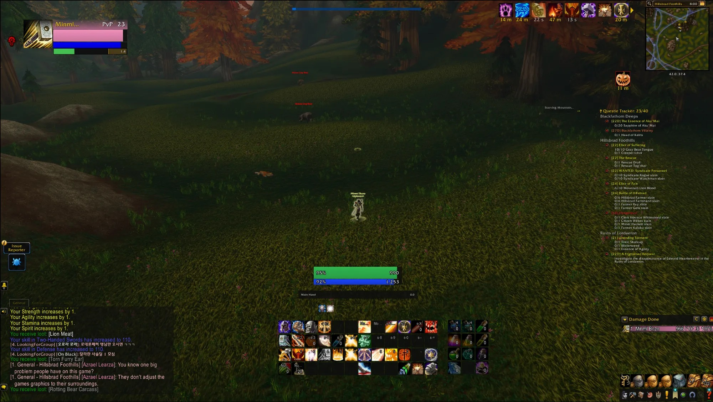
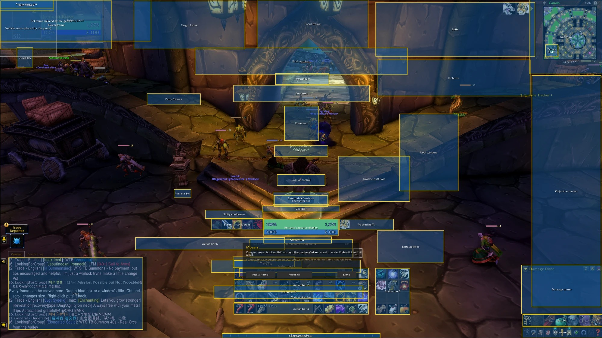

# Flat UI

Flat UI restyles the default interface in WoW: Forever with thin dark borders, flat backgrounds and flat bar fills. It has its own options window and profiles. It has handles to move and size frames and windows. It also draws combat numbers in front of enemy nameplates and in scroll areas beside your character. In your bags and bank it marks items that bind when equipped, tints items you cannot use red and marks the food a hunter's pet eats.

The **Errands** page, off by default, does the chores the game leaves to you: it sells grey items and repairs at merchants, loots every slot at once, makes room in full bags, learns everything at a trainer with one button, guards Release Spirit in dungeons, types DELETE for you, and can accept summons, resurrections and invites from friends or your guild, decline duels and keep the last mail recipient. Its **Levelling** tab accepts and hands in quests, picks gossip options, offers the new ranks of your spells for your action bars, shows the reputation you gain, reminds you of talent points and adds /way.

The **Data panels** page, off by default, adds a top and a bottom panel with bag space, gold across your characters, durability, your hearthstone, coordinates, frame rate and latency, friends and guild online, and the equipment set you wear, which a click changes.

The **Threat list** page, off by default, lists your group by threat on the enemy you fight, highest first, in class colours; at 100% a member has aggro. The **Healer mana** page, off by default, shows your healers' mana in dungeons and raids.

The **Drink and health macros** page, off by default, keeps two macros up to date with your bags and level: one drinks your best drink, conjured water first, and the other takes a healthstone, then a healing potion, and eats out of combat.

On party and raid frames, a debuff you can dispel colours the border of the health bar, with its type icon on party frames, and raid frames show raid markers.

The **Cooldowns** icons turn a spell red while your target is out of its range and blue while you lack the power for it, can show your healing potions, mana potions and healthstones with how many you carry, and can give each icon a ready sound of its own. Their **Cooldown pulse** tab, off by default, fades the icon of a spell, trinket or item you used in the middle of the screen when its cooldown ends.

Enemy cast bars on your target, focus and nameplates show whether your class interrupt is ready, and its icon on the cooldown row gets a gold border while your target or focus casts something you can interrupt.

**No target warning** and **Entering and leaving combat**, off by default on the **Combat text** page, show **No target** while you fight with no target or a dead or friendly one, and **+Combat** and **-Combat** as a fight starts and ends.

In the chat windows, a web address becomes a link that opens a box to copy it, and an item, spell or achievement link shows its tooltip while the mouse is over it. The **Tooltips** tab names what a unit targets, colours a player's class line and puts icons before item and spell names; with IDs on it shows the ID of the poison, oil or stone on your weapon, and **Show IDs** can wait for Shift, Ctrl or Alt. The items you wear show beside an item's tooltip only while you hold Shift.

The **Fading** page, off by default, fades bars and frames while nothing needs them, and can show the target and focus frames, your buffs and the objective tracker only in combat, in a group, in an instance or when not mounted.

**Hide error messages**, off by default on the **Tracker, loot and alerts** tab, hides the kinds of red error messages you choose in the middle of the screen, with their sound and voice: not enough mana, rage or energy, out of range, facing the wrong way, not ready yet, no or an invalid target, and not while moving. **Hide the zone name**, **Hide the subzone name** and **Hide the talking head**, off by default on the same tab, take away the big zone name and the talking head with its voice.

The **Flat UI** page can let the camera zoom out farther than the game's own options allow, and draw a ring around the mouse pointer, always or in combat only. The unit frames can hide the hit numbers the game flashes over your portrait and your pet's.



## Install

1. Download the newest file from [CurseForge](https://www.curseforge.com/projects/1750813) or from the releases of this repository.
2. Put the `FlatUI` folder in the `Interface\AddOns` folder of your WoW: Forever install.
3. Start the game and type `/flatui`.

## Commands

- `/flatui` opens the settings window.
- `/flatui setup` sets up a new profile step by step.
- `/flatui move` shows a box for every frame. Drag a box to move its frame.
- `/flatui status` says what is styled, and any error.
- `/flatui sell <item>` always sells an item at merchants (an item link or ID). Type it again to stop. `/flatui sell` alone lists the items.
- `/flatui keep <item>` never sells a grey item, and Make room never deletes it.
- `/flatui train` learns everything you can pay for at an open trainer, like the Train all button.
- `/flatui npc` skips the NPC you talk to or target: its quests and gossip are left to you. Type it again to stop.
- `/flatui gossip` lists the options of the NPC you talk to. `/flatui gossip 2` picks the second option for you from now on.
- `/flatui uprank` offers the new ranks of your spells for your action bars.
- `/flatui rank <spell>` keeps that rank where it is on your bars (a spell link or ID).
- `/way 45 61` puts a pin on your map and the game points you to it; `/way Elwynn Forest 45 61` for another zone, `/way clear` to take it off. `/flatui way` does the same when another addon has `/way`.
- `/flatui xp` says your experience per hour, time to level and kills and quests to level. `/flatui xp reset` starts counting again.
- `/flatui threat` shows sample bars of the threat list for a few seconds, out of combat; `/flatui healers` does the same for the healer mana list.
- `/flatui cooldown add healthstone` puts your healthstones on the cooldown row, every rank as one icon; `healing` and `mana` do the same for potions, and `/flatui cooldown remove` takes one off.
- `/flatui cooldown sound <spell> bell` gives one icon of the cooldown row its own ready sound; `row` gives it back the row's.
- `/flatui pulse test` shows a cooldown pulse; `/flatui pulse ignore <spell or item>` leaves one out and `/flatui pulse watch` puts it back; `/flatui pulse list` says what pulses.
- `/flatui help` lists the commands.



## Test

`FlatUI_test.lua` runs the addon in a simulated client. It needs Lua 5.4.

```
lua5.4 FlatUI_test.lua FlatUI
```

The last line must say `N passed, 0 failed`.

## Credits

The Errands page, the levelling stats of the experience bar, the cast bar's spell rank, the ammunition and durability checks, the text around the minimap, the data panels, the character and inspect overlays, the links in chat, the tooltip extras, the bag marks, the When shown rules of the Fading page, the error message filter, the camera distance and cursor ring of the Flat UI page, the hit numbers row of the unit frames, the threat list the range and power tints, potions and own sounds of the cooldown icons, the cooldown pulse, the interrupt colours and glow, the combat alerts of the Combat text page, the dispel border and raid markers of the party and raid frames, the healer mana list, the drink and health macros, the equipment set slot of the data panels and the zone name and talking head rows adapt features of [EnhanceQoL](https://www.curseforge.com/projects/1076354) by Philipp Barth (R41Z0R), with his permission: selling junk and auto repair, quick loot and the loot window junk button, Train All, the release guard, the popup helpers, auto-accepting invites, declining duels, remembering the last mail recipient, accepting and handing in quests, gossip options, the NPC exclude list, the quest count on the tracker, the spell rank upgrade, the learned-spell chat filter, watching the reputation you gain (on Flat UI's own bar), the /way command, the unspent talent reminder, the experience bar's quest stretch, experience per hour and time to level, the spell rank on the cast bar, the thrown weapons and the fitting ammunition of the ammunition tracker, the coordinates, durability, frame rate and time around the minimap, the durability tracker, the data panels, the item levels of the equipment flyout and the Inspect window with the inspected player's average, the durability on the Character window, the clickable web addresses with their copy box and the tooltips of links in the chat windows, the tooltip's target line, class line colour, icons, temporary enchant ID and IDs on a key, the bind on equip, unusable item and pet food marks in bags, the visibility rules of the target and focus frames, the buffs and the objective tracker, hiding the game's red error messages by kind, the maximum camera zoom, the cursor ring, hiding the hit numbers on the player and pet portraits, the threat meter of its damage meter, the range and power overlays, item entries with counts and sounds per entry of its Cooldown Panels, its Cooldown Pulse, its interrupt-ready cast bar colours and interrupt glow, its No Target Indicator and +Combat and -Combat text, its dispel indicator and raid marker on group frames, its Healer Mana indicator, its drink and health macros, its Equipment Sets stream, and hiding the talking head and the zone text. Thanks to him for sharing his work.

## Licence

MIT. See [LICENSE](LICENSE). The changes of each build are in [CHANGELOG.md](CHANGELOG.md). The parts adapted from EnhanceQoL are included with the permission of its author; EnhanceQoL itself is not under the MIT licence.
