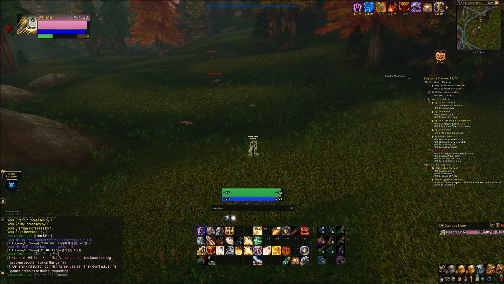
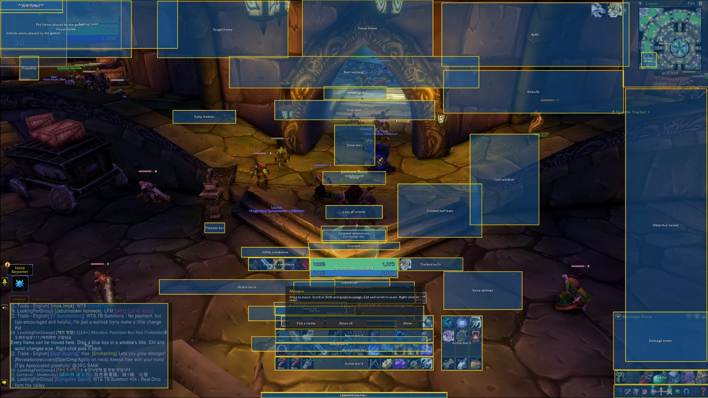

# Flat UI

Flat UI restyles the default interface in WoW: Forever with thin dark borders, flat backgrounds and flat bar fills. It has its own options window and profiles. It has handles to move and size frames and windows. It also draws combat numbers in front of enemy nameplates and in scroll areas beside your character.



## Install

1. Download the newest file from [CurseForge](https://www.curseforge.com/projects/1750813) or from the releases of this repository.
2. Put the `FlatUI` folder in the `Interface\AddOns` folder of your WoW: Forever install.
3. Start the game and type `/flatui`.

## Commands

- `/flatui` opens the settings window.
- `/flatui setup` sets up a new profile step by step.
- `/flatui move` shows a box for every frame. Drag a box to move its frame.
- `/flatui status` says what is styled, and any error.
- `/flatui help` lists the commands.



## Test

`FlatUI_test.lua` runs the addon in a simulated client. It needs Lua 5.4.

```
lua5.4 FlatUI_test.lua FlatUI
```

The last line must say `N passed, 0 failed`.

## Licence

MIT. See [LICENSE](LICENSE). The changes of each build are in [CHANGELOG.md](CHANGELOG.md).
