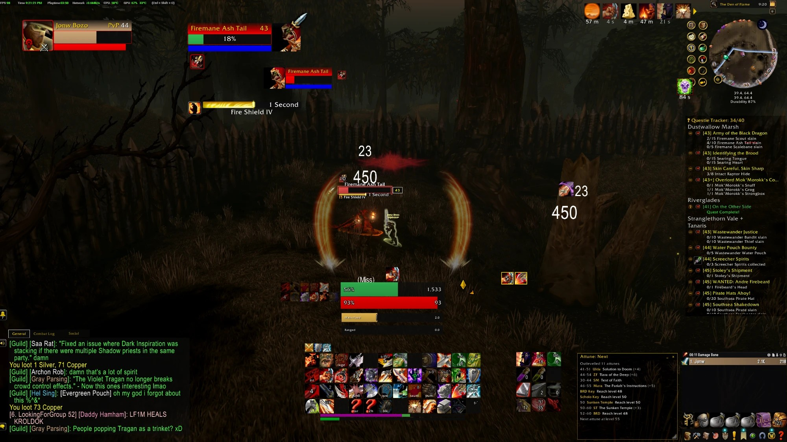

The **Combat text** page, in the **Combat** group, places the game's combat numbers where you can read them: in front of enemy nameplates, in columns beside your character, and over friendly units. It also adds warnings in the middle of the screen, such as No target and Low health, and can tell your group what you avoid while you tank.

## Combat text

The page has five tabs: **General**, **Scroll areas**, **Hits and colours**, **Friendly units** and **You and warnings**. Above the rows, each tab shows a picture of the numbers that follows every change you make. Point at a number in the picture to find its row. On **You and warnings** the picture shows the combat alerts instead.

### Where numbers show

Flat UI can put numbers in five places:

- Over enemies: your hits, in front of each enemy's nameplate. This is on as Flat UI comes.
- The Outgoing area: a column of your hits beside your character. It is off at first; **Where your hits show** turns it on.
- The Incoming area: the damage and healing on you, on the other side of your character.
- Over friendly units: the damage and healing on party and raid members, over their nameplates or their frames.
- The middle of the screen: the alerts, such as **No target**, **Low health**, **+Combat** and **-Combat**.

### Turning it on

**Place combat numbers**, at the top of the **General** tab, turns the whole page on. It is on as Flat UI comes. It changes a few of the game's own combat number settings to do its work. `/flatui combat` lists them, and `/flatui combat reset` puts them back to the game's defaults and turns **Place combat numbers** off.

**Numbers over enemies** picks how hits over enemies are drawn:

- **In front of nameplates** (the default): Flat UI draws the numbers in front of the nameplate, so the nameplate does not hide them.
- **As the game has them**: the game's own numbers, which show only your and your pet's hits, behind the nameplate.

### Look

The rows under **Look** set how every number is drawn.

- **Style**: **Classic** (the default) is the game's old floating text, rising straight up at a steady speed. **Flat UI** unlocks **Movement** and **Overlapping numbers** below.
- **Font**: **Arial Narrow** (the default), **Friz Quadrata (the game's damage font)**, **Skurri** or **Morpheus**. It is used for numbers in front of nameplates, the Outgoing area and your own text.
- **Outline** (**None** by default, or **Thin** or **Thick**) and **Shadow** (off).
- **How a number appears**: **With a pop, larger for critical hits** (the default) or **Plainly**. The scroll areas follow it too. **Classic** keeps its own look over enemies.
- **Partial effects**: what a Glancing, Crushing, Block, Resist or Absorb hit shows. **Word after the number** (the default), **Smaller number only** or **Off**.
- **Miss words**: Miss, Dodge, Parry, Immune and the other words show as a **Bare word** (the default), as "Dodge", or **In parentheses**, as "(Dodge)".
- **Size of miss words**: **Three quarters of the numbers** (the default) or **Same as the numbers**. This holds over enemies, over friendly units and in both scroll areas, so a Dodge does not look larger than the hits around it.

### Position and size

- **Height above the enemy** (60) sets how high the numbers start. With **As the game has them**, 40 is the game's own height. The numbers over friendly nameplates use it too.
- **Critical hits**: **Higher** (the default) starts a critical hit above the other numbers. **Same height** keeps it in line.
- **Size** (170%) sets the size of the numbers over enemies. 100% is the game's own size. Both scroll areas follow it by default.

### Spread and movement

- **Spread**: **Loose** (the default) spreads the numbers over an enemy to the sides, as far as **Spread width** (160%). **Tight** starts them all on one spot.
- **Movement**, with **Style** at **Flat UI**: **Burst** (the default) starts a critical hit large; the other numbers rise and fall. **Rise and fall** and **Straight up** are the other choices.
- **Overlapping numbers**, with **Style** at **Flat UI**: **Keep apart** (the default) starts a number in a free lane, or higher up. **Stay in turn** keeps them in order.
- **Rows** (4) is the most numbers stacked one above another.

### Scroll areas tab

The two scroll areas sit either side of your character. The Outgoing area holds your hits; the Incoming area holds the numbers on you.

**Where your hits show** decides where your hits go:

- **Over enemies** (the default): each hit shows over the enemy it hit, and nowhere else.
- **Scroll area**: only the hits on your target show, in the Outgoing area beside your character.
- **Both**: the numbers show over each enemy, and every hit on an enemy with a nameplate is also copied into the Outgoing area.

The Outgoing rows below are dimmed until you pick **Scroll area** or **Both**.

#### The Outgoing area

- **Outgoing style**: **Arc** (the default) curves out to the side, as far as **Arc width** (**Wide** or **Narrow**). **Straight** rises in a line, **Horizontal** slides sideways, and **Static** stays put and fades, stacking rows.
- **Size of the Outgoing area**: **Same as numbers over enemies** (the default), **Same as your text**, or **Smaller than numbers over enemies**. Big numbers over the enemy can go with a calmer column beside you.
- **Outgoing direction**: **Up** (the default) or **Down**. Horizontal and Static numbers stack their rows this way.

#### The Incoming area

These rows work while **Combat text for you**, on the **You and warnings** tab, is on.

- **Incoming style**: **Straight** (the default), **Arc**, **Horizontal** or **Static**.
- **Size of the Incoming area**: **Same as numbers over enemies** (the default) follows **Size**, so a hit on you reads as large as your own. **Same as your text** uses **Size of your text**. **Smaller than numbers over enemies** is the third choice.
- **Incoming direction**: **Down** (the default) or **Up**.

#### Both areas

- **Spell icons**: **All** (the default) shows the icon of your spell, swing or shot in the Outgoing area, and of your own heals on you in the Incoming area. **Spells only** leaves swings and shots bare, and **Off** shows none. Numbers over enemies and damage on you show no icon. The row is greyed while **Where your hits show** is **Over enemies** and **Combat text for you** is **Off**, as no area then draws an icon.
- **Speed**: how long a number stays. **Slow** (the default), **Normal** or **Fast**.

The lanes of both areas lie about a number's width apart, so a burst stays a tight column by its box instead of spreading across the screen.

#### Your interrupts

**Your interrupts** (off) pops "Interrupted" each time your interrupt stops an enemy's cast. It shows the icon of your Kick, Counterspell, Pummel or your pet's Spell Lock, in **Interrupt ready colour** from the **Colours** tab of the **Flat UI** page. You see each kick land without looking up.

- With **Where your hits show** at **Over enemies** (the default), it pops over the nameplate of the enemy you stopped, at the size of the miss words. This needs **Numbers over enemies** at **In front of nameplates**.
- With **Scroll area** or **Both**, it goes into the Outgoing area.

It shows when the game names you or your pet as the one who stopped the cast. When the game keeps that secret, it follows the target or focus cast bar turning Interrupted right after your interrupt, as **Sound when your interrupt lands** on the **Cast bars** page does. See [Frames and bars](Frames-and-bars). Test mode's target cast bar and `/flatui combat test` show it once.

**Also kicks that stop nothing** (on, under it) answers a kick that did nothing, where **Your interrupts** shows, with your interrupt's icon in **Interrupt on cooldown colour**:

- "Not interrupted" when your interrupt went off while your target or focus was casting and the cast went on: pressed half a second late, dodged or parried.
- "Too late" when another player's interrupt stopped the cast first.

It judges only once the game has named who stopped a cast this session, so it never guesses while the game keeps that secret. A cast that cannot be interrupted counts as neither. `/flatui status` counts both, as "Your interrupts: 4 shown." and "Kicks that stopped nothing: 2 Not interrupted, 1 Too late."

#### Classic

The rows under **Classic** shape the numbers while **Style** is **Classic**:

- **Colours**: **White and yellow** (the default) or **Red and purple**. **Colour by school of magic**, when on, takes their place.
- **Plus and minus signs over enemies** (off).
- **Rise distance** (175) and **Time on screen** (100%, the game's own 1.9 seconds).
- **Stacking**: as numbers come fast, **Older numbers move up** (the default) pushes the earlier ones higher, and **New numbers start lower** starts each new one under the last.
- **Critical hits stay in place** (on): a critical hit pops in larger where it starts and fades there, while the other numbers rise.

### Hits and colours tab

The rows under **In front of nameplates** pick which hits show over enemies, and their colours.

#### Whose hits

The game does not say who made a hit, so Flat UI works it out.

- **Yours** (the default) shows every hit on an enemy that only you and your pet are fighting, alone or in a party. Otherwise it shows one hit for each of your casts, swings, shots, auras and pet swings.
- **Everyone's** shows the hits of everyone on the enemy.

#### In a group

**Numbers over enemies in a group** picks what you see over enemies while you are in a group:

- **The game's own numbers** (the default) show every hit of yours and your pet's, behind the nameplate. They take **Size of experience and other gains**, as the game has one size for both.
- **Flat UI numbers** keep the numbers in front of the nameplate, but can miss a proc that casts nothing.

#### Which enemies and what colour

- **Enemies**: **Every enemy with a nameplate** (the default) or **Target only**.
- **Extra attacks**: with **Extra attack** (the default), an extra swing, such as Windfury or Hand of Justice, shows in white with "(Extra attack)" after it. In a group or with a pet out, it shows only when the game reports it as a swing of yours. **Off** turns this marking off.
- **Colour by school of magic** (off). Off, the hits of your spells are yellow and your swings and shots white. On, each hit takes its school's colour, so a Frostbolt shows light blue, a Fireball orange and a Shadow Bolt purple. Spells that hit you take their colour in the Incoming area too, while physical hits on you keep **Damage on you colour**.
- **Physical ability hits**: Maul, Heroic Strike and other special attacks show in **Yellow** (the default), as spells, or in **White**, as swings.

#### Spell names

**Spell names** writes the name of the spell after its number:

- **Next melee abilities** (the default) names Maul, Heroic Strike, Cleave and Raptor Strike.
- **After every spell** names every spell or special attack of yours, as "1,234 Fireball", over enemies and in the Outgoing area. Swings and shots stay bare.
- **Off** names none.

In the Outgoing area a named number takes a lane as wide as its name, so an Arcane Explosion or Multi-Shot on four enemies reads as clean columns instead of names printed over each other.

**Extra attacks**, **Physical ability hits**, **Spell names** and **Spell icons** need **Whose hits** at **Yours**.

### Friendly units tab

**Where friendly numbers show** puts numbers over party and raid members: **Both** (the default), **Friendly nameplates**, **Party and raid frames** or **Off**. With **Both**, the party and raid frames show numbers where friendly nameplates are not available.

- **Friendly units**: **Every friendly unit** (the default) or **Target only**.
- **Damage friendly units take** (on) and **Your pet** (on).
- **Healing over friendly units**: **Healing you do** (the default) is the game's own number, on your target only and behind the nameplate. **Healing they take from anyone** shows every heal on them. **Off** shows none.
- **Misses and dodges over friendly units** (off).
- **Plus and minus signs** (on): heals show + and damage shows -.
- **Friendly damage colour** (red) and **Friendly healing colour** (green). **Colour by school of magic**, when on, takes the place of the damage colour.
- **Size over friendly units** (100%, the game's own size).
- **Height above frames** (10) lifts the numbers over party and raid frames.

Friendly nameplates need the game's **Friendly Player Nameplates** option. `/flatui status` says when it is off.

### You and warnings tab

#### Your character

**Combat text for you** sets the numbers on you in the Incoming area:

- **Also misses, dodges and gains** (the default) shows damage and healing you take, and also misses, dodges and gains.
- **Damage and healing you take** shows only those.
- **Off** shows none.

While your text shows, the game's **Scrolling Combat Text for Self** is off, and its other messages do not show. That is why **Low health and mana warning**, below, brings back its Low Health and Low Mana.

- **Size of your text** (90%) sizes your own text. The Incoming area takes it while **Size of the Incoming area** is **Same as your text**.
- **Healing on you** (on). Turn it off and the Incoming area shows only what hurts you, so in a raid with five healers the heals do not hide the hits.
- **Damage on you colour** (red) and **Healing on you colour** (green). **Colour by school of magic** still takes the place of the damage colour for a spell.
- **Size of experience and other gains** sizes the text the game draws near you, such as experience: **Same as your text** (the default), **Smaller than your text**, **The game's own size** or **Same as numbers over enemies**.

#### No target

**No target warning** (on) shows **No target** in the middle of the screen, after a second, while you fight with no target or with a dead or friendly one.

- **Name the key to target an enemy** (on) adds the key bound to Target Nearest Enemy, as "No target  (Tab)". Nothing is added with no key bound, or while you heal.
- **Warn with a friendly target** (on). Turn it off for healing in a group, so a friendly target keeps the warning away. While you heal (by your group role, else most talent points in a healing tree, else as a priest), a living friendly target never brings the warning.
- **No target sound** (**None** by default) plays at most once every 3 seconds.
- **No target colour** and **Size of No target** (100%, the size of the game's own combat messages).

**No target** gently breathes while it shows, and fades out over a quarter of a second as you take a target.

#### Low health and Low mana

**Low health and mana warning** (on) brings back the game's own Low Health and Low Mana lines.

- **Low health** shows under No target while your health is under **Low health below** (20%; 5% to 50%), in **Low health colour** (orange).
- **Low mana** shows under it while your mana is under **Low mana below** (20%), in **Low mana colour** (blue).
- **Share on Low health and Low mana** (on) adds how low, as "Low health  14%", and follows every change. Turn it off for the words alone.
- **Glow at the screen's edges** (off) lays a soft glow in **Low health colour** along all four edges of the screen while your health is low, so you notice it while you watch the boss.
- **Only in a fight** (on) keeps them to fights. Turn it off to see them out of a fight too, as while you eat or drink.

A healer can set **Low mana below** to 35% and a tank **Low health below** to 30%. The lines take the size of **Size of No target** and breathe in step with it.

#### +Combat and -Combat

**Entering and leaving combat** (on) shows **+Combat** as a fight starts and **-Combat** as it ends, in the middle of the screen for a moment. They pop in a little larger and settle.

- **Entering combat colour** (red), **Leaving combat colour** (green) and **Size of +Combat and -Combat** (100%).
- **Fight length on -Combat** (on) says how long the fight lasted, as "-Combat  1:24".
- **Entering combat sound** and **Leaving combat sound** (**None** by default) play as each shows.

The sounds of this tab are **Spell alert**, **Chimes**, **Bell**, **Warhorn**, **Raid warning**, **Alarm** and **Whisper warning**. Picking one in the options window plays it once, so you can choose by ear.

### Announce to your group

**Announce blocks, dodges and parries** (off), under **Announce to your group** at the end of the **You and warnings** tab, tells your group what you avoid while you tank. It needs **Place combat numbers** on, as the combat alerts do.

#### When it sends

Lines go out while you count as a tank in a party or raid. You count as a tank by your group role, a tank stance or form, **Your role** on the **Threat** tab of **Nameplates**, or most talent points in a tank tree.

Each attack on you that you block, dodge or parry, or that misses you, sends a short line:

- "Dodged", "Parried" or "Missed me".
- "Blocked 245" when the game gives the blocked amount.
- "Blocked 120 of a hit" when a hit gets through your shield, 120 being your block value. Until Flat UI has read it, the line says "Blocked part of a hit".

Nothing is sent while you are alone, in a battleground or arena, outside a dungeon or raid while **Only in dungeons and raids** is on, while you do not count as a tank, or while the game closes addon chat, as it can in a boss fight.

#### Where and how often

- **Send to**: **Your group's chat** (the default) uses instance chat in an instance group, else raid chat in a raid and party chat in a party. **Party chat only** reaches, in a raid, the members of your raid group. **Raid chat only** sends nothing outside a raid. **Only me** writes the lines in your own chat window and sends nothing to anyone.
- **Only in dungeons and raids** (on): sends the lines only inside a dungeon or raid, so a party out in the world, questing with a friend, gets none. It holds for every line of this part, **Announce your interrupts** too. `/flatui announce` then says "nothing sent now, as you are not in a dungeon or raid".
- **How often**: **Each one** (the default) sends a line as it happens, at most one a second, counting the rest into the next line, as "Dodged x3" or "Dodged, Parried x2". **A summary every few seconds** sends "Last 5 s: 3 dodges, 2 parries, 4 blocks" after **Seconds of a summary** (5; 3 to 15). **One line when the fight ends** sends "Fight: 12 dodges, 8 parries, 15 blocks, 3 misses" as you leave combat, and waits up to 30 seconds for addon chat to open.

Never more than one line a second goes out, whichever you pick.

#### What it sends

**Announce blocks**, **Announce dodges**, **Announce parries** and **Announce misses** are on at first. **Announce resists**, **Announce immunities** and **Announce absorbs** are off. A resist or absorb counts only when it takes the whole spell or hit.

**Announce your defensives** (off) sends "Shield Wall up (12 s)" or "Last Stand up (20 s)" as you use a defensive with a cooldown of a minute or more, such as Shield Wall, Last Stand, Barkskin, Divine Protection or Evasion. It goes to **Send to**'s chat while you count as a tank, at most one line a second, so your healers know a big cooldown is running.

#### Announce your interrupts

**Announce your interrupts** (**Off** by default, at the end of the part) sends "Interrupted Shadow Bolt" each time the game names you or your pet as the one who stopped an enemy's cast. It needs neither **Announce blocks, dodges and parries** nor a tank role.

- Its choices are **Your group's chat**, **Party chat only**, **Raid chat only** and **Only me**, as **Send to** has them.
- It never claims another player's kick, and sends nothing while the game keeps that name secret.
- At most one line a second goes out. Nothing is sent alone, in a battleground or arena, outside a dungeon or raid while **Only in dungeons and raids** is on, or while the game closes addon chat.

Type `/flatui announce` to see where the lines go now, or why nothing is sent, whether you count as a tank, the last line sent, and where **Announce your interrupts** sends. `/flatui announce test` writes sample lines in your own chat window only; they are never sent. `/flatui status` counts the lines of each.

## Moving and trying the numbers

`/flatui move` shows three boxes for combat text. Drag them to move each part. See [Layout](Layout).

- **Combat text: your hits** is the Outgoing area.
- **Combat text: you** is the Incoming area.
- **Combat text: alerts** reaches from +Combat down to Low mana, so you can see where the low lines fall.

To see your settings without a fight:

- `/flatui combat test` shows sample numbers for you, over your target and over friendly units, then plays one quiet round of the alerts. Target an enemy with a nameplate to see the numbers over it. With **Your interrupts** on, it also shows "Interrupted" once.
- [Test mode](Test-mode) sends sample numbers and alerts while it runs.
- The picture above the rows of each tab follows every change.

## When something looks wrong

`/flatui status` explains most surprises. For example:

- "Numbers in front of nameplates: waiting for the first hit." The game's numbers show until Flat UI sees your first hit.
- In a group, the game's own numbers show over enemies by default. Set **Numbers over enemies in a group** to **Flat UI numbers** to keep Flat UI's.
- If your numbers show twice, the game kept its **Scrolling Combat Text for Self** on. `/reload` turns it off.
- No numbers over friendly nameplates: turn on the game's **Friendly Player Nameplates**.

`/flatui combat trace` prints each hit report of yours in chat, until you type it again. It helps when a hit seems to be missing.

## Commands for this page

| Command | What it does |
| --- | --- |
| `/flatui combat` | Lists the game's combat number settings: now, default and wanted |
| `/flatui combat test` | Shows sample numbers for you, over your target and over friendly units, and one round of the combat alerts |
| `/flatui combat reset` | Puts the game's combat number settings back to their defaults, and turns **Place combat numbers** off |
| `/flatui combat trace` | Prints each hit report and signal of yours in chat, until you type it again |
| `/flatui announce` | Says where **Announce blocks, dodges and parries** and **Announce your interrupts** send their lines now, or why they send nothing |
| `/flatui announce test` | Writes sample lines in your own chat window only, never sent to the group, with a defensive and an interrupt line while those rows are on |
| `/flatui status` | Counts the numbers shown, your interrupts and the lines announced, and says what stops a part |

See [Commands](Commands) for every command, and [Combat](Combat) for the rest of the **Combat** group.

Every setting of this group, with its default: [Settings: Combat](Settings-Combat).
