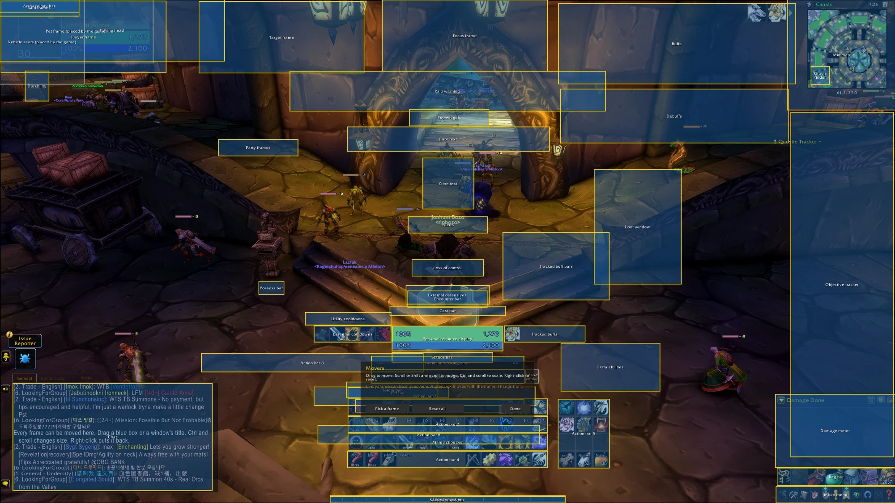

Flat UI has five pages for playing in a group: your party's cooldowns, a threat list, your healers' mana, a row of group tools and a ping bar. They sit in the **Group** group of the options window, in this order: **Party cooldowns**, **Threat list**, **Healer mana**, **Group tools** and **Ping bar**.

Every one of them is on in a new profile. In **Flat UI setup**, the **Helpers** stop has ticks for the **Threat list**, **Healer mana** and **Group tools**, and its **More settings** has a **Party cooldowns** step (see [Getting started](Getting-started)). `/flatui move` places each of these windows (see [Layout](Layout)), and test mode shows them all with sample content (see [Test mode](Test-mode)).

## Party cooldowns

**Party cooldowns** puts a row of icons beside each party member's frame: their interrupts, defensives and other key abilities, dark with a countdown while used, so you can see at a glance that the warrior's Shield Wall is gone or the rogue's Kick is back.

### Where the icons show

- **Party icons** (**Right of each frame**) puts the row to the right of each party frame, to the left, or below it.
- **Your own row** (off) adds a row for your own cooldowns while you are in a party, just above the first member's row.
- **In a raid group** (**Own position**): in a raid, Flat UI shows a stack of rows for the members of your own subgroup instead, each with their name in their class colour, and your own row on top while **Your own row** is on. The stack has its own box in `/flatui move`, named **Party cooldowns: raid group**. **Off** shows no rows in a raid.
- **Rows stack** (**Down**) sets which way the raid stack grows. **Up** keeps the bottom of the stack on the bottom of its box in `/flatui move`, with your own row still on top. Use it for a stack placed above your action bars, so new rows grow upward instead of down over the bars.

### What the icons show

- **Show** (**Always, used ones dark**) shows every ability Flat UI can follow: bright while it is ready, dark with its sweep while it is cooling down. **Only while on cooldown** shows an icon only while its ability is used.
- **Icons for each member** (6, from 3 to 8) and **Icon size** (24) set how many icons a row holds and how large they are.
- **Icon border** (on) gives each icon a thin border on a dark background. With **Border colour by kind** (on) the border takes a colour for each kind, so interrupts and defensives stand apart; off, it has the border colour of the **Flat UI** page.
- **Time left** (on) writes the seconds left on a used icon, and **Countdown number size** sets their size.
- **Icon tooltips** (**On**): pointing at an icon names the ability and the member, and says Ready or the time left. **Out of combat only** keeps the tooltips out of a fight. Clicks still go through to the party frame.
- **Dim members out of range** (on) fades the row of a member the game says is out of range to 45%, also in a fight, so it matches a party frame dimmed by range. In a raid, their name fades with it.
- A dead or offline member's row fades to 35%.

### Which abilities show

Under **Abilities**, five rows choose the kinds of ability that show:

- **Interrupts** (on), such as Kick and Pummel.
- **Defensives** (on), such as Shield Wall, Evasion and Divine Shield.
- **Defensives cast on others** (on), such as Blessing of Protection.
- **Crowd control breaks** (off).
- **Group cooldowns** (off).

Flat UI learns of a use when it sees the member cast the ability or gain its buff. An ability that not every member of a class has, such as one from a talent, shows for another member only once Flat UI has seen them use it, or once their own Flat UI has told yours that they have it (see **Sharing** below). An ability that needs a level shows only for a member of that level or higher.

To change the list:

- **Add an ability** lists the abilities that do not show now. Pick one to add it. Added abilities come first in a row.
- **Hide an ability** lists the abilities that show. Pick one to hide it.
- For a spell that is not in the list, type `/flatui party add`, then its spell ID and its cooldown in seconds. You can also give a listed ability by name and change its cooldown, as `/flatui party add Pummel 12`.
- `/flatui party hide` takes a name or a spell ID, as `/flatui party hide 6552`.
- `/flatui party list` prints the abilities that show, by class, and says for each member whether they share cooldowns.
- `/flatui party reset` puts the list back as Flat UI ships it and says what it undid, as "3 added, 2 hidden and 1 cooldown undone".

You can add up to 30 abilities. What you add or hide is saved for your whole account, not for one profile, so resetting a profile leaves it; `/flatui party reset` is the way back.

### Ready again

- **Flash when ready** (off) gives an icon a white flash as its cooldown ends.
- **Sound** (**None**) plays as a party icon's cooldown ends, at most once a second, so a healer hears that the interrupt or Shield Wall is back. You can pick **Spell alert**, **Chimes**, **Bell**, **Warhorn**, **Raid warning**, **Alarm** or **Whisper warning**. Picking one plays it.
- **Shortest cooldown that sounds** (0 s, up to 300 s) keeps short cooldowns quiet. At 60 s, a rogue's Kick ends in silence while Shield Wall, Blessing of Protection or Innervate still ring. At 0, every cooldown sounds.

### Sharing

**Share cooldowns with the party** (on) sends your cooldowns to party members who also run Flat UI, and in a raid to the members of your subgroup who do. Their icons then show your cooldowns exactly, with the right time left, even where the game hides other players' casts. When you join a group or reload, the running cooldowns come across as far along as they are on the sender's screen.

A member whose Flat UI shares with you gets "Shared by Flat UI" in the icon tooltip. Sharing works in a party, and in a raid with your subgroup: the members of your subgroup who run Flat UI share their cooldowns with you, and yours go to them. `/flatui party list` says who shares.

### Trying it out

- In test mode, while you are in no group, sample rows show in the raid group stack: Mara, Eli, Ivo and Fay, and your own row while **Your own row** is on. The sample Ivo is dead, so that row fades to 35%, and the sample Fay is out of range, so that row fades to 45%. With the test mode bar's **Group** at **Solo**, only your own row shows, while **Your own row** is on. The sample sweep plays your **Sound** once. In a real group, test mode puts the sample icons on your real rows.
- `/flatui test icons` shows three sample icons for 8 seconds on each row, while your rows show and out of combat. They flash and sound at their end as **Flash when ready** and **Sound** say.

### When nothing shows

`/flatui status` says when the game hides party members' casts where you are, when it blocks the messages Flat UI uses to share cooldowns, and when your raid subgroup had to be read from the raid roster. See [Troubleshooting](Troubleshooting).

## Threat list

The **Threat list** lists your group by threat on the enemy you fight, highest first, in class colours. At 100% a member has aggro, or takes it. It warns you before you pull an enemy off your tank, and, while you tank, when an enemy turns to someone else.

### When it shows

The list shows only in a fight. **Show** (**In a group**) sets where: **In a group**, **In a dungeon or raid**, or **In a group or alone**.

It follows the first of these that is an enemy:

1. your target;
2. your target's target;
3. with **Follow your tank's target** (on), the enemy your group's tank fights;
4. while you tank, the enemy you are losing most (see **List** below).

**Follow your tank's target** is for a healer who heals by clicking party frames, with no target or another healer targeted. The tank is found by their tank role, the raid's main tank, or in a party their tank stance, form or aura. The title then names the tank after a dim dot, in a light shade of their class colour, as "Defias Pillager · Mara", and the list turns to the tank's next enemy within a second.

The list is about enemies the game keeps threat on, not enemy players. It fades in and out instead of popping up, the small enemy rows with it, so the window never snaps shorter before it goes.

### Reading the bars

- Each bar shows a member's share of the threat that pulls aggro. Pointing at a bar names the member and says what the share means, as "86% of the threat that pulls aggro: at 100% they take it", or "Holds aggro", then what applies to them, such as your own **Warn at** or that they are close to your aggro.
- The title shows the enemy's name, with its raid marker before it, so you can tell which of three Defias Pillagers the list is about.
- **Pets** (on) adds a bar for each pet, a shade darker than its owner's.
- **Mark your own bar** (on) draws a thin white outline round your bar.
- **Always show your bar** (on): when you rank below the last bar, your bar takes the place of the last one, with your place before your name, as "12. Jon".
- **Animate bars** (on): bars slide to each new value over a fifth of a second, a row glides to its new place and flashes as it overtakes another, and the top bar has a faint sheen. Your group's names take a light shade of their class colour. Off, the bars jump and stand still, and the warnings still pulse.
- The bars take no clicks, so a click still reaches the world.

### Warnings for damage dealers and healers

- **Warn near aggro** (on): while you are not tanking, your bar pulses red once your share passes **Warn at** (90%), and **Warning sound** (**Raid warning**) plays once for that enemy. It plays again for that enemy only after your share falls 10 points under **Warn at**.
- Once you hold the enemy's aggro, your bar keeps a steady red wash. If the sound has not played yet, it plays then, so a sudden pull is heard too.
- The threat list's sounds never wait on another Flat UI sound, such as **Entering combat sound** at the pull or a party cooldown that ends: they always play, at most one every third of a second among themselves.

### Warnings for tanks

Flat UI counts you as a tank by your group role. With no group role, you count as a tank in your tank stance, form or aura (such as Defensive Stance, Bear Form or Righteous Fury), as the raid's main tank, or with **Your role** at **Tank** on the **Threat** tab of **Nameplates** (see [Nameplates](Nameplates)). Failing those, Flat UI goes by the talent tree with the most points, such as Protection. It reads this as each fight starts. `/flatui role` says how nameplate threat reads you.

- **Warn when you lose aggro** (on): when an enemy you held turns to someone else, your bar pulses red for up to 2 seconds and **Warning sound** plays once. The bar of whoever took it pulses red with yours, and the title names them in red, as "Thistlefur Avenger > Ivo", so you see whom to taunt it off. The red stops as soon as your taunt lands, and your bar flashes once in a light shade of **Threat you want**, with no sound.
- **Show who is near your aggro** (on): the bar of any member at **Warn at** or above who is not tanking turns a steady amber, with no sound. You see the Mage at 96% before their next crit and can taunt or ask them to slow down.
- **Calm when another tank takes it** (on), for groups with two tanks: when an enemy goes from you to another tank (their tank role, the raid's main tank, or in a party their tank stance, form or aura), no sound plays, neither bar pulses and their bar never turns amber as they build threat. Anyone else taking it still sets everything off. Once the other tank taunts an enemy back from whoever pulled it off you, the red stops at once and the title goes back to the enemy's name.

### List

**List** chooses what the window shows.

- **Your target, then enemies you are losing** (the default) shows your group on your target, with all the rows, colours, warnings and sounds above. While you tank, it adds what happens around you: under a thin line, up to 4 small rows for the other enemies with a nameplate that you are losing. **Lost** ones come first, then **Slipping** ones. Each row has the enemy's raid marker, its name, its colour and pulse, and who holds it or closes in, as "Mage 112%". Past 4, a dim last line counts the rest, as "+2 more, 1 lost, 1 slipping". While one of them is lost, the title reads "Defias Pillager · 1 lost". While no other enemy is lost or slipping, nothing is added, so a fight against one enemy looks as it always did.
- **Enemies you fight** shows the enemies instead of the group, in every role. Each enemy with a nameplate that fights you or your group gets a row, up to **Number of bars**, and a last line counts the rest, as "+3 more, 1 lost". The title reads "Threat: 3 enemies, 1 lost".
- **Your group on your target** shows your group alone, never the enemies under it.

With **Your target, then enemies you are losing**, while you tank with no enemy as your target, your target's target or your tank's target, the list shows your group on the enemy you are losing most: a **Lost** one first, else the closest **Slipping** one, with the other lost and slipping enemies under it. On a Lost one, the title names who holds it in red, as "Defias Pillager > Mage", and their bar keeps a steady red wash, so you see whom to taunt it off without targeting it. **Calm when another tank takes it** keeps another tank calm there too, and with **Warn when you lose aggro** off the title and bars stay plain. The window stays when your target dies mid-pack or is cleared, comes back within a second as an enemy turns Lost, and follows your next target as you Tab.

#### Lost, Slipping and Held

In the enemy rows, each enemy has a bar of your hold on it: your threat against the highest of the others'. It is full while no one else has threat on it, half-way at an even split and empty once another member has twice yours. A faint tick marks the half and **Slipping at**.

- **Lost**: someone else holds the enemy. The row is red, pulses fast and names who holds it, in their class colour, with their share of your threat ("Mage 112%").
- **Slipping**: another member's threat passes **Slipping at** (80%, under **Enemies**). The row is amber, pulses slowly and names who closes in ("Rogue 86%").
- **Held**: the rest. The row is green, calm and a little dimmer, with the closest share.

The colours are those of **Threat you do not want**, **Threat changing hands** and **Threat you want** on the **Threat** tab of **Nameplates**, so the list and the plates agree. With **Calm when another tank takes it**, an enemy another tank holds stays calm, in **Another tank's colour**. **Slipping at** is also where the magnified plate of an enemy you are losing starts to grow on nameplates.

Lost enemies come first, then Slipping ones (closest first), then Held ones, so the top row is the one to take back. Your target's row has a thin white outline. When an enemy you held turns Lost, its row flashes and **Sound when you lose an enemy** plays. Its default, **Warning sound**, plays the sound of **Warning sound** while **Warn when you lose aggro** is on. Your target itself keeps **Warn when you lose aggro**. When you take a Lost enemy back, as your taunt lands, its row flashes once in a light shade of **Threat you want**, with no sound. Under your target, where only Lost and Slipping enemies are listed, that shows while it is still Slipping, as it is right after a taunt; one that turns straight to Held leaves the rows.

The enemy rows take no clicks. Pointing at one says who has it and to click the enemy's nameplate to target it; the words follow the row as the enemies change places under the mouse. Flat UI reads the enemies five times a second, twice in a raid, only in a fight, and nothing out of one, so a big pull in a raid keeps its frame rate.

### Bosses

On bosses, the game hides threat. The list then keeps the order of your group, with the pets after the members, and pointing at a bar says "The game withholds the threat on this enemy." None of the warnings fire there. `/flatui status` says when this happened on the last enemy.

### Size and place

- **Number of bars** (5, from 1 to 10). The small rows of the enemies under your target count apart from it.
- **Bars stack** (**Down**). **Up** keeps the bottom of the list on the bottom of its box in `/flatui move`, so more bars push the title up: for a list above your action bars or player frame. The small rows of the enemies you are losing then sit above the title, inside the window, so the title and the group bars stay put as those enemies come and go.
- **Bar width** (180 px), **Bar height** (16 px, also the height of the text) and **Bar texture**.

### Trying it out

- `/flatui threat` shows sample bars for 8 seconds, out of combat.
- In test mode, the sample group's threat moves every 2 seconds. As damage or healer, your sample bar takes aggro now and then. As a tank, the sample Mage takes the enemy from you at their turn, so your bar and theirs pulse red and the title reads "Sample > Mage". On the next step you take it back and your bar flashes. The sample Rogue climbs to 94% and turns amber between the Mage's turns. The sample Tank takes the enemy from you for one step after the Rogue's: with **Calm when another tank takes it** on, nothing pulses and no sound plays, and with it off, both bars pulse red there.
- With **Your target, then enemies you are losing**, the samples show two Defias under the group, one lost and one slipping, in every role. With **Enemies you fight**, they show four Defias: one lost, one slipping and two held. In test mode their states turn every 6 seconds, so you can see the flash, the sound (once each time test mode comes on) and the rows moving.
- With **Pets** off, the samples leave out the sample Wolf and Voidwalker.

## Healer mana

**Healer mana** shows the mana of your group's healers, so you know when to pull. It shows in a group with a healer. **Show** (**In a dungeon or raid**) can also be **In a group**.

### Who counts as a healer

Flat UI goes by the group roles. A member with the healer role counts; a member with the tank or damage role never does. In a group where nobody has picked the healer role, it counts the classes that heal: Priest, Paladin, Shaman and Druid. It still leaves out:

- yourself, while your talents are in a damage or tank tree, as a Retribution paladin or a Feral druid;
- anyone in their tank stance, form or aura, such as Righteous Fury or Bear Form.

This is read again as talents change and after each fight, so the list, its average and ready are about the real healers.

**Your own bar** (on): off leaves you out of the list, its average and ready. A priest who heals a dungeon alone then sees no window at all, and in a raid sees only the other healers.

### Reading the bars

- Each healer has a bar in their class colour, in the order of your group.
- **Low mana at** (30%, 0 means never): a bar turns red below it, also in a fight, where the game hides the number.
- **Show who is drinking** (on): out of combat, a cup and the seconds left on the drink show on the bar of a healer who drinks, as "18s 47%", counting down until they stand. Where the game gives no time, it reads "Drinking 47%".
- **Dim healers out of range** (on) fades the bar of a healer too far from you, also in a fight.
- A dead or offline healer's bar reads Dead or Offline.
- Out of combat, while the game shows the numbers, the title reads the average mana of your living healers, as "Healer mana 64%", red while under **Low mana at**.
- Past **Number of bars**, a dim last line counts the healers not shown, with the lowest mana among them, as "+3 more, lowest 22%", red while that is under **Low mana at**. The title's average and ready count them too, so a pull on ready never leaves the seventh healer drinking at 20%.
- Pointing at a bar names the healer in their class colour and says "Mana 47%" (in a fight, where the game hides the number, "Mana hidden in a fight"), Dead or Offline, the seconds left on a drink, as "Drinking: 12 seconds left", and whether they are under **Low mana at** or **Ready at**. Pointing at the last line lists the healers not shown, up to 10, with their mana. The bars still take no clicks, so a click reaches the world.
- Shift-click the title to put the healers' mana in the chat line, opening one if none is open, ready to send, as "Healer mana: Eli 82%, Mara 47% (drinking 12s), Fay Dead". It names every healer, also those past **Number of bars**. In a fight, where the game hides the numbers, chat says so instead.

The window fades in and out, and its bars glide to each new value.

### Ready to pull

- **Ready at** (90%, 0 means never): out of combat, once every healer has at least this much mana and none is dead or offline, the title turns green and reads "Healer mana 97% · ready", with a short soft pulse.
- **Sound when ready** (**None**) plays once as the healers turn ready, so a tank can pull without staring at the bars. It rings again only after a healer dropped under **Ready at**, and stays quiet at login, on zoning and in a fight. Picking one plays it.

### Size and place

- **Number of bars** (5, from 1 to 40).
- **Bars stack** (**Down**). **Up** keeps the bottom of the list on the bottom of its box in `/flatui move`, so more bars grow upward: for a list above your action bars.
- **Bar width** (150 px), **Bar height** (16 px, also the height of the text) and **Bar texture**.

A title too wide for the window, with a large **Bar height** or a narrow **Bar width**, shortens to "Healers 97% · ready", then "97% · ready" (and "Healers 64%", then "64%"), so the word ready is never the part cut off.

### Trying it out

- `/flatui healers` shows three sample healers for 8 seconds, out of combat. They never read ready.
- In test mode, the sample Druid's drink counts down from 18s to 1s. Then for 4 seconds every sample reads ready (96%, 100% and 93%), so you can see the green title, its pulse and **Sound when ready** (once each time test mode comes on), and it starts again.
- With the test mode bar's **Group** at **Raid 10**, **Raid 20** or **Raid 40**, the sample holds eight healers, so you can judge **Number of bars** and **Bars stack** while placing the list. At 5 bars, the last line reads "+3 more, lowest 22%" in red.

## Group tools

**Group tools** adds a row of buttons for your group: the eight raid markers, Skull first, and a clear for your target, then a ready check, a role poll and a pull countdown. `/flatui move` places the row.

### When it shows

**Show** (**In a group**) can also be **As the leader or an assistant** or **In a group or alone**. A button you cannot use now is greyed, and its tooltip says why, as "Only the leader or an assistant can do this." Under **Buttons**, **Raid markers**, **Ready check**, **Role poll** and **Pull countdown** (all on) turn each part of the row on or off.

The buttons are protected by the game, so the row shows, hides or changes only out of a fight. A change made in a fight waits for its end, and with the options window open, chat says "Flat UI: the group tools change when the fight ends."

### Raid markers

- Left-click a marker to put it on your target, or to take it off. Right-click takes your target's marker off.
- Shift-click puts a marker on yourself, and Ctrl-click on your focus, in a fight too. Shift- or Ctrl-right-click takes theirs off.
- On the clear button, left-click takes the marker off your target, and a plain right-click takes every marker off. Shift- or Ctrl-click, with either button, takes off only yours or your focus's.
- The button of the marker your target wears lights up in that marker's colour, also in a fight, and its tooltip says a left-click takes it off.
- The tooltips of the markers and the clear name the game's own marker keys where you bound them.
- In a raid, only the leader and assistants can mark.

### Ready check

Only the leader or an assistant can start one. During a check, the tick shows how many are ready, as 3/5: green when all are, amber when someone is not. It flashes white the moment the last member answers ready, and **Sound when all are ready** (**None**) plays once with the flash. Its tooltip names who is not ready or has not answered, in class colours. The result stays for 8 seconds after the check.

### Role poll

The role poll asks everyone to pick a role. Only the leader or an assistant can start one, and not in a group the dungeon finder made or in a battleground.

- Its tooltip lists who has which role, in class colours, as "Tank: Mara" and "Damage: Ivo, Fay". In a raid it gives the counts, as "Tanks 2 · Healers 8 · Damage 28".
- It lists in amber who has no role. In a party, it also adds "No healer" or "No tank" in amber when nobody holds that role.
- Once anyone in the group holds a tank, healer or damage role, a small amber number in the button's corner counts the members with no role. It is grey while you cannot start a poll, and goes at 0.
- While nobody has picked a role, as in most groups on Forever, the number does not show and the tooltip says "Nobody has picked a role yet."

### Pull countdown

- Left-click counts down **Countdown length** (10 s, from 3 to 60) for the group, with the game's own countdown. Right-click stops it. Only the leader or an assistant can start one.
- Out of combat, the mouse wheel over the button makes **Countdown length** a second longer or shorter.
- During any countdown in the group, whoever starts it, the button counts the seconds left, the last three in red, and stops when someone cancels it. At 0 it flashes and reads "Go" in green for a moment, then shows **Countdown length** again.
- Its tooltip follows along and names who started it, as "Mara counts down: 7 seconds left. Right-click stops it.", then "Go!".

### Keys

Under **Flat UI** in the game's Key Bindings, you can bind **Group tools: Ready check**, **Group tools: Pull countdown** (it counts down **Countdown length**) and **Group tools: Stop the countdown**. They work in a fight, and while the row is hidden or a button is turned off. Once bound, the tooltips of the ready check and the pull button name them, as "Key: F9 counts down, Shift-F9 stops it".

### Look

- **Button size** (24) and **Spacing** (3).
- **Layout** (**In a row**) can also be **Markers above the rest** or **In a column**.
- **Borders in the marker's colour** (on): each marker's border takes its colour, star yellow, circle orange, diamond purple, triangle green, moon silver-blue, square blue, cross red and skull white.
- **Fade until you point at it** (off): the buttons stay faint (30%) until the mouse comes over one, come back to full at once, and fade again a second after the mouse leaves. They still take clicks. They stay full during a real ready check or countdown, and while its "Go" shows, in a fight too.

### Trying it out

In test mode:

- the tick shows a sample tally of 4/5, with a sample Eli not ready, for 6 seconds, then 5/5 in green with the flash for 4 seconds, again and again. **Sound when all are ready** plays once each time test mode comes on;
- the pull button counts down from **Countdown length**, again and again, red at the end and flashing with "Go" at each 0;
- the Skull is lit as a sample target's marker;
- the role poll's tooltip lists sample roles, and its count reads 1 for the sample Kai.

The sample tally and countdown hold still while the test mode bar's **Moving** is off. The samples keep nothing full, so you can try **Fade until you point at it** there.

## Ping bar

The **Ping bar** gives you a button for each ping of the game's ping wheel, with the game's own icons: **Ping** (the game picks the kind), **Attack**, **Warning**, **On My Way** and **Assist**. `/flatui move` places the bar.

### When it shows

**Show** (**In a group**) can also be **Always** or **Never, only its keys**. The bar hides while pings are off in the game's options, or while your group lets only some members ping and you are not one of them. In a fight, when the bar stays shown, the tooltip of a button says why it cannot ping.

Like the group tools, the bar changes only out of a fight. A change made in a fight waits for its end, and with the options window open, chat says "Flat UI: the ping bar changes when the fight ends."

### Pinging with a click

1. Click a button. The cursor turns into the game's ping cursor, the button lights up in its ping's colour, and a line by the bar names the ping that waits.
2. Click anywhere on the screen to ping that spot for your group, in a fight too.

While a ping waits, click another button to switch to it. Click the same one again, right-click or press Esc to cancel. A ping that waits gives up after 10 seconds out of combat, or as the fight ends if it waited through one, so a stray click never eats your next click on the world.

Shift-click pings your target at once. With no target, it works as a plain click.

The button of a ping that goes out flashes white once, so a sent ping and one the game refused for its wait look different. **Cooldown swipe** (on) shows a swipe on the buttons while the game makes you wait before the next ping.

### Keys

Each ping has a key of its own under **Flat UI** in the game's Key Bindings: **Ping: Ping**, **Ping: Attack**, **Ping: Warning**, **Ping: On My Way**, **Ping: Assist**, **Ping: Not a threat** and **Ping: Threat**. A key pings what is under the mouse at once, as the game's own ping keys do: hover the spot, press the key.

Each button's tooltip says what a click and a Shift-click do and names its keys. **Keys on the buttons** (on) shows each button's key in its top right corner, short as on action bars ("M4", "s-F"), and follows as soon as you rebind. With **Show** at **Never, only its keys**, the keys still ping with no bar on screen.

### Choosing the buttons

Under **Pings**, a row for each of the five, **Ping**, **Attack**, **Warning**, **On My Way** and **Assist** (all on), chooses which buttons the bar shows. If you only use Attack and Warning, you can drop the rest. The bar closes up around the buttons left, and every key under Key Bindings still pings.

### Look

- **Button size** (24) and **Spacing** (3).
- **Layout** (**Horizontal**) can also be **Vertical**. The line that names the waiting ping hangs inward from the bar, so it stays on screen with the bar at an edge or laid out as a column.
- **Borders in the ping's colour** (on).
- The keys on the buttons keep a third of **Button size**, whatever the **Fonts** page sets.
- **Fade until you point at it** (off) keeps the buttons faint until the mouse comes over one, and fades them again a second after it leaves. They still take clicks and keys, and stay full while a ping waits, in test mode too, so you can try it there.

## Commands

| Command | What it does |
| --- | --- |
| `/flatui threat` | Shows sample bars of the threat list for 8 seconds, out of combat. |
| `/flatui healers` | Shows sample bars of healer mana for 8 seconds, out of combat. |
| `/flatui party add Pummel 12` | Adds an ability to **Party cooldowns**, by name, spell ID or a shift-clicked spell, with its cooldown in seconds. |
| `/flatui party hide 6552` | Hides an ability, by name or spell ID. |
| `/flatui party list` | Lists the abilities shown and who shares cooldowns. |
| `/flatui party reset` | Puts the abilities back as Flat UI ships them, undoing every add, hide and typed cooldown. |
| `/flatui test icons` | Shows three sample icons for 8 seconds, on party cooldown rows among others. |
| `/flatui role` | Says whether nameplate threat reads you as a tank, and why. |
| `/flatui move` | Shows the boxes to place the threat list, healer mana, group tools, ping bar and the raid group stack of party cooldowns. |
| `/flatui status` | Says what is styled, with notes such as hidden casts or withheld threat. |

See [Commands](Commands) for every command.

Every setting of this group, with its default: [Settings: Group](Settings-Group).
