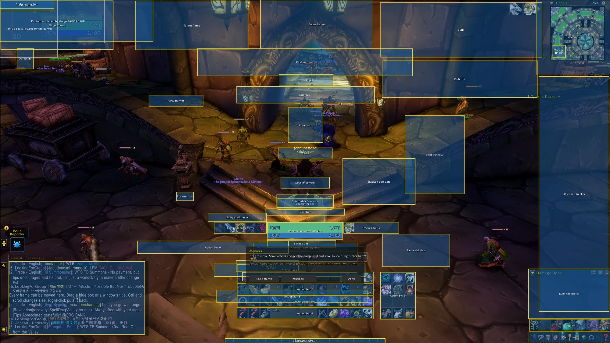

The **HUD** group styles what sits round the edges of your screen: the minimap, your buffs and debuffs, the quest tracker and loot, the game's messages and timers, the experience and reputation bars, and two panels of facts such as gold and bag space. This page walks through each of its pages in the order the options window lists them.

## Minimap

**Restyle the minimap and HUD** (on), at the top of the **Minimap** page, is one switch for the **Minimap**, **Buffs and debuffs**, **Quests and loot**, **Messages and timers** and **Experience and menu bars** pages, and for the **Hit table** page under **Character and gear** too. Each of those pages shows the same switch at its top. The **Data panels** page has a switch of its own.

### The map

- **Hide minimap ring and header** (on) takes off the game's ring and header art. A rotating minimap loses its north pointer.
- **Minimap shape** is **Square** (the default) or **Round**. Square also takes the ring and pointer off the map.
- **Minimap border** (on) draws a thin border round the map, the zone name and the buttons beside it.
- **Minimap in cities**: inside some cities the game shows its own city map in the minimap. Choose **Flat round cover** (the default), **Game's ring while the city map shows** or **Leave as is**.
- **Zoom out after** (0 s, which is off, up to 60 s) zooms a minimap you zoomed in back out to its widest once that time has passed with the mouse off it. It steps out one zoom level at a time, so you see it happen. The mouse coming over the map stops it where it is.
- **Day and night icon** (on): untick it to hide the game's day and night icon.

### Zone name

- **Zone name** (on) shows the name of where you are above the map, at **Zone name size** (100%, 50% to 200%).
- **Close the gap under the zone name** (off) brings the zone name, with the clock, calendar and tracking button beside it, down to the map. The map stays where it is. The mail icon and the addon list button go to the other side of the zone name if they no longer fit. While the game's ring shows, and while Edit Mode is open, the zone name keeps the game's place.
- **Gap under the zone name** (0 px, up to 40 px) sets the room left under it. At 0 the zone name lies on the map's border.

### Buttons

**Tracking button**, **Mail icon**, **Calendar button**, **Clock** and **Addon list button** are all on. Untick one to hide that button. **Clock** is the game's clock beside the zone name; Flat UI's own **Time** line is under **Text around the map** below.

**Addon buttons** gathers the round buttons that other addons put on the minimap:

- **Column beside the map** (the default) or **Row under the map** lines them up neatly.
- **Where each addon puts them** leaves them alone.
- **Leave in place** lists the buttons it found. A button you tick there stays where its addon put it.
- **Flat addon buttons** (on) gives each gathered button a square dark plate with a thin border in place of its round gold ring, and a light square when you point at it. A button you tick in **Leave in place** keeps its own art.

To show the minimap buttons only while the mouse is over the minimap, turn on **Minimap buttons** on the **Fading** page (see [Layout](Layout)).

### Text around the map

Four lines of text can sit above or below the map. Each has its own place row, **Above the map** or **Below the map**.

- **Coordinates** (on, below the map): your place on the zone map. **Coordinate decimals** is **One (45.3, 62.1)** by default, or **None (45, 62)** or **Two (45.31, 62.08)**. The line is hidden in instances, where the game gives no position. It also hides while the game's own coordinates show under the map (the game's Options, Interface, Coordinates), so you see your place once. Turn the game's off to have Flat UI's line, with its tooltip and Shift-click.
- **Durability** (on, below the map): your most worn equipped item, yellow at 50% or less and red at 20% or less. **Durability shows** is **Always** by default. Pick **At 50% or less** or **At 20% or less** and the line only comes as an item wears to that mark, and goes again after a repair. The lines under it close up while it is away.
- **Frame rate and latency** (off, below the map): frames per second, then your home and world latency in milliseconds. **Show** picks **Frame rate and latency**, **Frame rate only** or **Latency only**. **Latency** picks **Home and world** (the default), **The higher one**, **Home only** or **World only**. Home is chat and the auction house; world is combat and other players. **Colour by value** (on) turns the frame rate yellow under 60 and red under 30, and the latency yellow over 100 ms and red over 200 ms.
- **Time** (off, above the map): **Local time** or **Realm time** (**Local or realm time**), in **24 hours (14:05)** or **12 hours (2:05 PM)** (**Time format**).

**Text size** (100%, 70% to 160%) sizes all four lines at once, and also the coordinates on the world map and the name of who pings.

#### Pointing and clicking

The lines answer the mouse, in a fight too, and their tooltips stay up to date as you walk.

| Line | Point at it for | Click | Shift-click |
| --- | --- | --- | --- |
| Coordinates | the zone and subzone | opens the world map | puts the place in chat, as "Elwynn Forest 45.3, 62.1" |
| Durability | each item you wear | opens the character window | |
| Frame rate and latency | both latencies and Flat UI's memory | lets clicks through | |
| Time | local time, realm time and how long this session has run | opens the stopwatch and alarm | opens the calendar |

Shift-click on the coordinates puts the line in the chat box you have open, or in one Flat UI opens for you. The lines that take clicks show a faint light under the mouse.

In a fight, a window waits. Chat says once, as "Flat UI: the stopwatch opens when the fight ends.", the tooltip's hints say "after the fight", and the window opens as the fight ends.

**Tooltips in combat** at **Hide every tooltip**, on the **Combat and extra lines** tab of **Tooltips**, hides these tooltips in a fight with every other tooltip. See [Chat and windows](Chat-and-windows).

#### Samples

While test mode is on, and in `/flatui move` with **Samples** on, each ticked line that has nothing real to show shows a sample at its place: "45.2, 61.8", a yellow "Durability 42%", "62 fps   48 / 95 ms" and "14:05". So you can see where a line sits in a dungeon or with repaired gear. Point at one and it says "A sample while test mode is on." See [Test mode](Test-mode).

### World map and pings

- **Coordinates on the world map** (on) puts a small line at the bottom of the world map: "You 45.2, 61.8" while you are on the map shown, and "Cursor 33.0, 12.5" while the pointer is over the map. It follows **Coordinate decimals** and **Text size**. Your part is hidden in instances.
- **Name of who pings the map** (on) writes the name of a group member who pings the minimap by the ping, in their class colour, for about 3 seconds before it fades. A new ping moves it, and your own pings show none. Test mode shows a sample name at a new spot every 5 seconds. Where the game withholds who pinged, or gives addons no minimap pings, `/flatui status` says so.

### Border and background

**Own border and background** (off) gives every page of the minimap and HUD its own **Border colour**, **Background colour** and **Background opacity** (85%). Off, they use the look of the **Flat UI** page.

## Buffs and debuffs

The **Buffs and debuffs** page styles the game's buff and debuff icons.

- **Buff and debuff borders** (on) gives square icons with a thin border. **Icon crop** (8%, 0% to 15%) trims the edge of buff, bag and loot icons.
- **Border colour by debuff type** (on) colours a debuff's border by its type: **Magic**, **Curse**, **Disease** and **Poison** each have a colour row. **Other debuffs** colours bleeds and debuffs with no type.

### The time on a buff

**Duration format**, **Duration colour** and **Red under** also cover the totem times under the player frame.

- **Duration size** (100%) and **Stack count size** (100%) size the time and the stack count.
- **Duration format**: **No space (8m)** by default, **As the game has it (8 m)**, or **Minutes and seconds (28:41)**. With minutes and seconds, a flask or Arcane Intellect reads 28:41 or 1:05 before a pull, then plain seconds in its last minute. An hour or more keeps the short form, as 2h.
- **Duration colour**: **White** by default, in place of the game's gold. **White, red near the end** turns a time red once **Red under** (10 s, 3 to 60 s) is left, and white again on a fresh buff, so a buff about to drop stands out. 60 s suits a flask, 3 s a Sunder Armor. A time the game withholds in a fight stays white. **As the game has it (gold, white under 90 s)** gives the game's colours back.
- **Tenths below** (0 s, which is off, up to 10 s) writes the last seconds of a buff or debuff with tenths, as 4.8, 4.7. A rogue can refresh Slice and Dice at the last moment this way. The time still turns red at **Red under**. Totem times stay in whole seconds, as the game gives them.

Test mode's sample buffs and debuffs follow all of these rows.

## Quests and loot

### Objective tracker

- **Tracker headers** (on) puts a flat band with a thin border behind each heading, at **Heading size** (100%).
- **Tracker background** (off) puts Flat UI's background and thin border round the tracker.
- **Tracker bars** (on) gives progress and timer bars a thin border and a flat fill, in **Tracker bar texture**.
- **Tracker item buttons** (on) makes quest item buttons square with a thin border.
- **Opacity in combat** (100%) eases the tracker to this opacity as a fight starts and back as it ends. Under the mouse it comes back to full.

The **Objective tracker** row of the **Fading** page can fade the tracker too. See [Layout](Layout).

### Quest count

**Quest count** (on) shows your quests and the most the log holds, as 12/20, at the right of the Quests heading. It is red while the log is full.

- **Warn as the log fills** (on) turns the count amber at one free slot. When the log becomes full while you play, the count gives a short red pulse and chat says once "Flat UI: your quest log is full (20/20)." The first count after you log in or reload never warns.
- **Quests ready in the count** (on) adds how many of your quests are ready to hand in, as "12/20  3 ready", in the experience bar's **Quest colour**. The count pulses once as another quest becomes ready.

Point at the count for your quests, those ready to hand in and their experience. A click opens the quest log, in a fight as the fight ends.

### Questie's tracker

**Questie's tracker** (on) gives that addon's quest tracker the look of the rows above: the background, the heading bands, **Heading size** on its zone headings, the item buttons and **Opacity in combat**. While the **Fonts** page is on, its lines take the interface font too. Without that addon the row does nothing. Off, the tracker keeps its own look, and its own settings are never changed.

### Loot window

**Loot window** (on) gives the loot window a flat look, with thin borders on the window, the cards and the item slots. **Quality word on loot** (on) keeps the game's quality word on each card; untick it to hide the word.

### Loot rolls

**Loot rolls** (on) gives each roll a flat background and thin border, the item's icon with a border in its quality colour, the name in that colour, a flat timer bar, and **Need**, **Greed** and **Pass** in a row. Off gives the rolls the game's look back.

- **Seconds left on rolls** (on) counts down the whole seconds left to roll at the right end, just above the timer. Under 10 seconds the number and the bar turn red.
- **Sound before a roll ends** (**None** by default, or **Spell alert**, **Chimes**, **Bell**, **Warhorn**, **Raid warning**, **Alarm** or **Whisper warning**) plays once when a roll you have not rolled on has 5 seconds left, in a fight too. So a roll that came during a pull is not passed unseen. Several rolls ending together give one sound, and picking a sound plays it.
- **Rolls stack** is **Up** (as the game stacks them) or **Down**.

Move the rolls with the **Loot rolls** box in `/flatui move`. Until you do, the game places them. Right-click the box to give them back to the game. Test mode shows sample rolls, with their seconds and sound.

### Alerts

**Loot, money and honour alerts** (on) gives the game's alerts a flat background with a thin border.

## Messages and timers

### Error messages

**Hide error messages** (on) hides the red error messages you choose in the middle of the screen, with their sound and voice. Other red errors and the yellow quest messages show as usual.

These kinds are hidden as Flat UI comes:

- **Not enough mana**
- **Not enough rage or energy** (also a hunter pet's focus, and no combo points for a finisher)
- **Out of range** (also too far away to attack, and too close for a ranged attack)
- **Facing the wrong way** (also not in front of or not behind the target)
- **Not ready yet** (spells, abilities, items and potions still cooling down)
- **No target or invalid target** (also nothing to attack, and a dead target)
- **Not while moving**

These are off until you tick them:

- **Not in line of sight**
- **While stunned, silenced or feared** (also pacified, confused or charmed: the messages of a key you press while you cannot act)
- **Wrong stance or form** ("Must be in Battle Stance", "Can't use items while shapeshifted" and the like). An NPC that will not talk to you while shapeshifted still says so.

**When** is **Always** by default. **Only in a fight** hides them only in combat and shows every message out of it, so you still learn why a cast on a mob or a mailbox failed.

**Error text size** (100%, 50% to 150%) sizes the red error lines and the yellow quest lines at once, also with **Hide error messages** off. With the options window open, a change prints a sample "Not enough mana" at the new size.

### Zone titles and talking head

- **Hide the zone title** (off) takes away the big zone name that fades in as you enter a zone, and its PvP line.
- **Hide the subzone title** (off) takes away the smaller name of a part of a zone, such as a town.
- **Zone title size** (100%, 50% to 150%) makes the zone name, its PvP line and the subzone name smaller or larger. With the options window open and test mode off, a change shows a sample at their real place for 3 seconds. 100% is the game's size.
- **Hide the talking head** (off) takes away the portrait that speaks at the bottom of the screen, and its voice.

The **Zone text** and **Error text** boxes of `/flatui move` place these lines. With **Samples** on, or in test mode, the boxes show sample text so neither is placed blind.

### Timers

- **Breath and fatigue timers** (on) gives the breath, fatigue and feign death bars a thin border and a flat fill in the cast colours.
- **Seconds on the timers** (on) puts the time left, as "1:12", at the right under the bar, with the label still centred. While the bar drains, the time turns red under 10 seconds. It stays white while your breath comes back.
- **Countdown timers** (on) gives pull and start timers a thin border and a flat fill.

Move the bars with the **Timer bars** box in `/flatui move`. In test mode, while no real timer shows, a sample Breath bar drains over 30 seconds at that spot.

### Damage meter

- **Damage meter header** (on) puts a flat band with a thin border in place of the game's header.
- **Clear the damage meter** is **Off** by default. **When you enter a dungeon or raid** clears it as you go in, and **Ask when you enter one** asks first. It does not clear again for the same instance within an hour, so a reload or a run back after a wipe keeps the numbers.
- **At each raid boss** (off) also clears it as a raid boss fight starts, without asking.

### Queue and zone bars

**Queue status panel** (on) and **Zone event bars** (on) give the queue panel and the score and progress bars of a zone a thin border.

## Experience and menu bars

### Flat UI's bar or the game's

**Experience bar** is **Flat UI's** by default. The game's bar then stays in place but is not drawn. Pick **The game's** to keep the game's own bar; then only **Flat fill** and **Hide bar dividers** (both on) and a few look rows apply to it, and none of them while **Leave the game's action bars alone** is on (on the **Flat UI** page, on as Flat UI comes). A change of this row made in a fight lands as the fight ends.

The rest of this section is about Flat UI's own bar.

### Size and place

- **Experience bar under the bar block** (on) puts the bar right under block 1 at the block's width while the **Bar block** page is on. That page is off as Flat UI comes, so the bar keeps its own place and **Width**. See [Action bars](Action-bars).
- **Width** (42%, 10% to 130%), where 100% is the game's bar at full width, and **Height** (8 px).
- **Bars shown**: **Experience and reputation** (the default), **Experience only** or **Reputation only**. **Top bar** picks which one is on top, and **Space between bars** (2 px) the gap.
- Move the bar with the **Experience bar** box in `/flatui move`. The **Experience bar** row of the **Fading** page can fade it.

### Look

- **Bar border** (on) and **Bar background** (on): the empty part of each bar is its background, inside a thin border, so a bar at low experience still reads as a bar from end to end.
- **Dividers**: **None** (the default), **4**, **10** or **20**.
- **Experience colour** fills the bar. With **Rested experience** (on), a stretch shows how far your rested experience reaches, and the fill takes **Rested colour** while you are rested.
- **Reputation fill** is **By standing** (the default) or **One colour**, with **Reputation colour**.
- **Bar texture** sets the fill's texture.

### Text

- **Bar text**: **As the game has it** (the default), **Percent**, **Value and percent**, **Amount to go** or **Hidden**. Large numbers read as the game writes them, as 12,150 / 27,000.
- **Rested share in the text** (on): with **Percent** or **Value and percent**, the text ends with your rested share in **Rested colour**, as "+30%", while you are rested.
- **Bar text shows**: **On mouse-over** (the default) fades the text in as the mouse comes over the bar. **Always** keeps it there. **As the game has it** shows it on mouse-over and also whenever the game would show its own bar text, as its experience bar text setting or the character window does.
- **Bar text place**: **On the bar** (the default), **Above the bar** or **Right of the bar**, at **Bar text size** (105%).

### Tooltip and clicks

**Tooltip** (on) shows your experience, rested experience and standing as you point at a bar. The experience tooltip says what is left under its first line, as "To level: 14,850 (55%)", and the rested line reads as "Rested: 8,000 (30% of the level)". The reputation tooltip reads as "4,200 / 12,000 (35%)" and "To Revered: 7,800". While a hunter's pet is out and still below their level, the experience tooltip shows its experience too.

**Clicks on the bar** (on):

- Shift-click either bar to put your progress in the chat box, ready to send, as "Level 34: 12,345 / 27,000 (45%), 1h 20m to level" or "Stormwind: Honored 4,200 / 12,000 (35%)".
- Click the reputation bar to open your reputations, in a fight as the fight ends.
- Ctrl-click either bar to count the session from now, as `/flatui xp reset` does. The pace, time to level and reputation pace start fresh, for example after a break or a switch from questing to grinding.

A click counts only when you let go over the bar you pressed. The bar shows a faint light under the mouse while it takes clicks.

### Gains you can see

- **Animate gains** (on): the fill slides up to its new value at each kill or hand-in, and the stretch you just gained lights up and fades. A new level flashes the whole bar soft gold, and a new standing with the same faction flashes it in the new standing's colour. Another faction, a lower standing or a loss sets the bar at once.
- **Gains over the bar** (on): each gain rises as a small "+1,240" from the end of the experience fill and fades. A reputation gain rises as "+75" in its standing's colour, and a loss as "-250" in red. A new level rises as "Level 35" in gold, and a new standing as its name, such as "Honored", in its colour. It shows in a fight too.

With **Moving** on, test mode plays a sample gain every 4 seconds; every third one is a new level with the gold flash.

### Levelling

- **Quests ready to hand in** (on) adds a stretch after the fill, in **Quest colour**, for the experience of the finished quests in your log. When a quest becomes ready while you play, the part it adds lights up for a moment.
- **Levelling text** adds a short text after the bar text, or alone while **Bar text** is **Hidden**: **Time to level** (the default), **Experience per hour**, **Time to level and per hour**, **Kills to level** or **None**. **Reputation text** does the same on the reputation bar: **None** (the default), **Time to next standing**, **Reputation per hour** or **Both**. The pace is your last 30 minutes of play, without time away, and shows after 5 minutes.
- **Levelling in the tooltip** (on) adds this session's experience and pace, the time to level, about how many kills and quests that takes, and, after /played, your time at this level. On the reputation bar it adds the reputation this session, its pace and the time to the next standing.
- **Level up line in chat** (on): at each new level, one line says how long the level took and your play this session, as "Flat UI: level 35, after 1h 42m at level 34 (2h 10m of play this session)." The time of a level shows once you levelled in this session or typed /played.
- **Line when your quests are enough to level** (on): once a level, chat says when your finished quests hold enough experience for the next level, as "Flat UI: your 3 finished quests are enough to reach level 35." A /reload does not say it again.

The reputation bar shows the faction you watch. With **Show the reputation you gain**, on the **Quests and levelling** tab of **Errands**, it shows the faction you last gained reputation with. See [Helpers](Helpers).

### Bag bar and micro menu

**Bag bar buttons** (on) makes the bag buttons square icons with a thin border, without the bar frame. **Micro menu buttons** (on) gives the micro menu a thin border in place of the game's button frames.

## Data panels

The **Data panels** page adds a top and a bottom panel of text, each with up to six slots: bag space, gold, durability and more. **Show data panels** is on, but both panels are off until you show them.

- **Show the top panel** (off) puts a panel at the top of the screen, under the game's battleground scores, until you move it. Its slots are at first **Bag space**, **Gold**, **Durability**, **Hearthstone**, **Coordinates** and **Frame rate and latency**.
- **Show the bottom panel** (off) puts a panel in the bottom left corner. Its slots are at first **Friends online** and **Guild online**, with the other four at **None**.
- **First slot** to **Sixth slot** choose what each slot shows. A slot with nothing to show takes no room.
- **Panel width** (0 px) fits the panel to its slots. A larger width makes the panel wider than its slots.

Place the panels with the **Top data panel** and **Bottom data panel** boxes in `/flatui move`.

### What a slot can show

| Slot | Shows | Click |
| --- | --- | --- |
| **Bag space** | free slots out of all your bag slots; its tooltip says what your grey items and sell list fetch at a merchant | opens or closes your bags |
| **Gold** | your gold; its tooltip lists each character's gold and what you made or spent this session | Ctrl-click counts the session from now |
| **Durability** | your durability in percent, with how many items are broken in red; its tooltip lists the lowest first with the repair cost | opens the character window |
| **Ammunition** | your arrows or bullets, or the stack of a thrown weapon, as "Ammo 1,840", gold at the **Ammunition minimum** of the **Trackers** page and red when out | |
| **Soul shards** | a warlock's shards, red at none | |
| **Hearthstone** | where you are bound, with its cooldown counting down | uses your Hearthstone, out of a fight |
| **Coordinates** | your place on the zone map | opens the world map; Shift-click puts it in chat |
| **Zone** | the subzone, or the zone, in green, red, gold or blue for friendly, hostile, contested or sanctuary | opens the world map; Shift-click puts it in chat |
| **Time** | local or realm time, as the game's clock is set | opens the stopwatch; Shift-click opens the calendar |
| **Quest log** | your quests, red when the log is full; its tooltip lists those ready to hand in and their experience | opens the quest log |
| **Experience** | your share of the level, and the rested share in blue | Shift-click puts it in chat |
| **Reputation** | the faction of Flat UI's reputation bar, else the one the game watches, with its standing and share | opens your reputations; Shift-click puts it in chat |
| **Frame rate and latency** | frames per second and latency | |
| **Friends online** | how many friends are online | opens the friends list |
| **Guild online** | how many guild members are online | opens the guild window |
| **Equipment set** | the equipment set you wear | changes the set |

A slot that shows nothing for this character takes no room: **Soul shards** for a warrior, **Ammunition** without a bow, crossbow, gun or thrown weapon, **Experience** at the top level. A window a click opens in a fight opens as the fight ends, with a line in chat that says so. Feeds that other addons offer can fill a slot too.

### Choosing a slot's content with the mouse

Right-click a slot for a small menu under it, titled with the panel and the slot, as "Top panel, third slot". The one shown now is gold with a tick. What shows nothing for this character reads dim, with why, as "Soul shards (only for a warlock)".

- **Move left** and **Move right** swap the slot with its nearest shown neighbour and keep the menu open, so each press moves it on.
- **Add a slot after this one**, there while the panel has a slot set to **None**, puts a new slot right beside the one you clicked.
- The last line, **Data panels options**, opens the page.

On a slot that shows another addon's feed, a plain right-click stays that feed's own; Alt-right-click opens Flat UI's menu. Each move or add is one line in Home's **Recent changes**, so you can undo it.

### Gold

Each change of your gold floats from the **Gold** slot, as "+38s 2c" in green or "-1g 4s" in red. A quick run of changes shows as one sum.

The gold tooltip lists each character of your account that logged in with data panels on. From ten minutes in it also says what this session makes an hour. Ctrl-click the slot to count the session from now; chat says "Flat UI: the gold count of this session starts again now." **Forget a character's gold**, at the bottom of the page, takes a character off the list.

### Look

- **Font**: **Flat UI Sans** (the default) or **Game font**. A language it has no letters for keeps the game font. **Text size** is 120%, where 100% is 12 px.
- **Background and border** (on) gives a flat background with a thin border and a line between two slots, in the colours of the **Flat UI** page.
- **Text outline** (**None**, **Thin** or **Thick**) and **Text shadow** (on).
- **Text colour**: **White** (the default), **Class colour** or **Own colour** with **Own text colour**. A slot's own colours stay, such as red for worn gear.
- **Colour frame rate and latency** (on) colours them as by the minimap: frame rate red under 30, latency red over 200 ms.
- **Tooltips** (on) shows a slot's tooltip as you point at it. Off, the slots that do something on a click keep their clicks, and **Gold** and **Frame rate and latency** let clicks through.
- **Opacity in combat** and **Opacity out of combat** (both 100%) fade the panels. Under the mouse a panel rises to full in a tenth of a second and settles back as the mouse leaves. While `/flatui move` or Edit Mode is open, the panels show at full, so you can line them up.
- **Layer**: **Under the game's windows** (the default), **Over the unit frames and the minimap**, or **Over the game's windows**, where a panel can cover your bags and the map.

## Placing the HUD frames

`/flatui move` shows a box for each frame you can place. The HUD ones include **Minimap**, **Buffs**, **Debuffs**, **Objective tracker**, **Experience bar**, **Loot rolls**, **Error text**, **Zone text**, **Timer bars**, **Talking head**, **Damage meter**, **Micro menu**, **Bag bar**, **Top data panel** and **Bottom data panel**. Drag a box to move its frame, and right-click it to put the frame back. See [Layout](Layout) for all that `/flatui move` does.

## Commands

| Command | What it does |
| --- | --- |
| `/flatui xp` | Says your experience this session and per hour, the time to level, about how many kills and quests that takes, the quests ready to hand in, and your reputation this session and its pace. Needs **Restyle the minimap and HUD** on. |
| `/flatui xp reset` | Counts the session's experience and reputation from now, as a Ctrl-click on the bar does. Chat says "Flat UI: the experience and reputation count starts again now." |
| `/flatui move` | Shows the boxes to place the minimap, the tracker, the experience bar, the loot rolls, the data panels and the other HUD frames. |
| `/flatui status` | Says what is styled, with notes such as why the names of who pings do not show. |
| `/way 45 61` | Puts a pin on your map there, and the game points you to it. `/way Elwynn Forest 45 61` works for another zone, and `/way clear` takes the pin off. It belongs to **Errands**; see [Helpers](Helpers). |

See [Commands](Commands) for every command.

Every setting of this group, with its default: [Settings: HUD](Settings-HUD).
