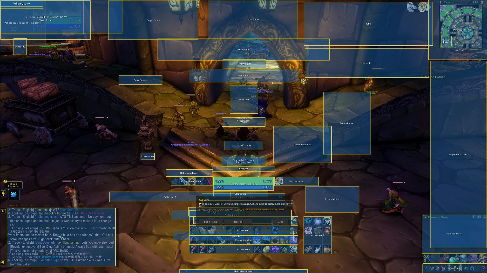

The **Layout** group decides where things sit and when they show. It holds four pages: **Movers**, **Fading**, **Hidden frames** and **Tooltip position**. The boxes you drag to move frames open with `/flatui move`, or with the **Move frames** row at the top of the options window's sidebar.

## Move frames

**Move frames**, above the groups in the sidebar, opens the same boxes as `/flatui move`. Every frame Flat UI can move gets a box: the game's unit frames, action bars, minimap, buffs, chat and the rest, Flat UI's own frames such as the cooldown icons, trackers and combat text, and the game's windows. Drag a box to move its frame.

### Opening and closing

- Type `/flatui move` to open the boxes, and again to close them. The first time after a login or reload, chat explains how the boxes work.
- **Done**, on the toolbar or the lower **Movers** panel, ends the session and keeps your changes.
- Escape first lets go of any selected boxes. With nothing selected, it asks **Keep your changes?** and says how many frames moved. **Keep moving** goes back to the boxes, **Discard** puts every frame back as it was when you opened them, and **Keep** keeps them.
- While the boxes are open, every faded frame is at full, so a frame at 0% is never an empty box. After **Done**, faded frames wait **Wait before fading** and fade again.

The boxes do not open in a fight. Typed in a fight, `/flatui move` says "Flat UI: /flatui move opens when the fight ends." and the boxes open as it ends; typing it again in the same fight takes that back. The **Move frames** row reads **After combat** while you are in a fight. If a fight starts while the boxes are open, chat says "Flat UI: Movers pause for combat." and they open again as it ends.

### Moving one frame

| Action | What it does |
| --- | --- |
| Drag | Moves the frame. |
| Mouse wheel | Nudges it up or down by a pixel. |
| Shift and mouse wheel | Nudges it left or right by a pixel. |
| Ctrl and mouse wheel | Changes its size in 5% steps, from 50% to 200%. Windows go from 60% to 150%. |
| Right-click | Puts it back where the game has it. |
| Shift and right-click | Hides a HUD frame of the game, as a tick on the **Hidden frames** page does. |

A grey box moves with the frame it hangs from. A hidden frame the game has not placed yet has no box. A name too long for its box is cut short; point at the box to see it drawn over the others with its whole name.

### Snapping and centring

- A box you drag snaps to the middle of the screen when its middle is within 8 units of it (**Snap while dragging**).
- It also snaps to other boxes: a guide shows when an edge or the middle of the box lines up with another box within 5 units. **Snap to other frames**, on the **Options and setup** tab of the **Flat UI** page, turns this on or off.
- The **Snap** switch on the toolbar turns both on or off at once.
- **Centre a handle with** sets how you centre one box across the screen, at its height: **A button on the handle** (the default), **Alt and click**, or **Both**.
- With **Centre everything** at **A button in the Movers panel**, tick the box on each handle you want centred, then press **Centre ticked**.
- **Middle line** draws a line down the middle of the screen: **Shown while dragging** (the default), **Always shown with the handles** or **Off**.

### Selecting several frames

- A click on a box selects it alone. Shift or Ctrl and click adds a box to the selection or takes it away, as on a name in the frame list.
- Press on empty space and drag to draw a rectangle. Every box it touches is selected as you let go, except the boxes of frames the game places. Shift and drag adds them to the selection, Ctrl and drag takes them away.
- A click on empty space, or Escape, lets go of them all.
- Drag any selected box and the others move with it, keeping their places to one another. With **Snap** on, the box under the mouse snaps and the others follow it.
- The arrow keys move what is selected 1 unit, Shift and an arrow key 10.

With two or more selected, the inspector reads, for example, "3 frames selected" and offers:

- **Align left**, **Align right**, **Align top** and **Align bottom**.
- **Centre horizontally** and **Centre vertically**, on the middle of the space they cover together.
- **Distribute across** and **Distribute down**. The outer two stay put and the gaps between them all become the same. These need three or more frames.
- **Reset these**, which puts each selected frame you moved back where the game has it.
- **Hide these**, beside it, which hides every selected frame that has a row on the **Hidden frames** page, as a tick there does. It reads **Show these** when all of them are hidden already, and shows them again. It is dimmed when no selected frame has such a row, and chat names once any selected frame that has none, as "Flat UI: Chat has no row on the Hidden frames page, so it stays."

A frame that is hidden, not on screen now or placed by the game stays put in these group moves, and the inspector says how many stay put.

### The inspector

With one box selected, the inspector at the right shows its **X** and **Y**, a **Scale** slider with its own box, and buttons for **Centre** and **Reset**. A HUD frame of the game also gets **Hide frame**, which reads **Show frame** once it is hidden. Type a number in **X**, **Y** or the scale box to place the frame exactly. A frame the game places, or one not on screen now, reads **Not available** for its position.

### The toolbar

- The grid: **Off**, **Dim** or **Bright**. It draws lines every 32 units behind the frames, with the middle of the screen marked. **Movers grid**, on the **Options and setup** tab, sets the same choice.
- **Snap** turns snapping on or off.
- **Samples** turns test mode on or off, so frames that are hidden until a fight, a target or a group show samples in their boxes while you place them. See [Test mode](Test-mode).
- **Frame list** shows or hides the list of frames at the left.
- **Undo** puts back the last change, and Ctrl-Z does the same. **Redo** puts back what **Undo** took away, and Ctrl-Y or Ctrl-Shift-Z does the same. Their tooltips say how many steps each holds.
- **Done** ends the session and keeps your changes.

A group drag, a run of arrow presses less than a second apart, an align, a distribute, **Reset these**, **Reset all** or **Centre ticked** each count as one **Undo** step, however many frames they change. A new move clears what can be redone.

### The frame list

The frame list sorts every box into groups: **Hidden**, **Unit frames**, **Action bars**, **Flat UI**, **Windows** and **Other**. Type in its search box to narrow it. Click a name to select its frame, or Shift or Ctrl and click to add it or take it away. The eye at the right of a row hides that box while you work. On a row of the **Hidden** group, the eye shows the frame again.

### The Movers panel

The lower **Movers** panel holds four buttons:

- **Pick a frame**: point at any frame on the screen and press Alt to give it a box of its own. Shift picks the frame around it. While picking, the button reads **Stop picking**.
- **Reset all** puts every moved frame back where the game has it. Click it twice. **Undo** takes it back.
- **Centre ticked** centres each ticked handle across the screen, at its height.
- **Done** ends the session and keeps your changes.

You can drag the panel out of the way.

### Bars in a bar block

While the **Bar block** page is on, its blocks have one box each, **Action bar block** to **Action bar block 3**. Drag the tab on a bar of a block to give it another place in the block, or to put it in another block. See [Action bars](Action-bars).

### Commands

| Command | What it does |
| --- | --- |
| `/flatui move` | Shows or hides the boxes that move frames. |
| `/flatui move reset` | Puts every moved frame back where the game has it. |
| `/flatui move reset windows` | Puts every window back to its default place and size. |
| `/flatui grab` | Opens the boxes with **Pick a frame** running: point at a frame and press Alt to take it. In a fight it starts when the fight ends; a second one in the same fight takes it back. |

## Movers

The **Movers** page holds the switches and rules behind `/flatui move`. Its first row, **Move frames**, is on as Flat UI comes. With it off, `/flatui move` only says in chat that the movers are off.

### Frames of the game

- **Move the game's own frames** lets the boxes move the player frame, the minimap and the game's other frames. Edit Mode still works, and a frame moved here stays where you put it. While **Leave the game's action bars alone** is on (on the **Flat UI** page), the game's action bars stay where the game puts them, except the bars of a block of the **Bar block** page.
- **Bars on a preset layout**: an Edit Mode preset layout cannot hold moved bars. With **Copy into a Flat UI layout**, the Reload button can copy the preset into a layout named Flat UI. **Leave the preset** leaves it as it is.
- **Edit Mode layout as text**: pick **Show as import text** to open a box with your layout as text. Copy it, open Edit Mode, choose Import in the layout list, paste it and name it Flat UI. Close Edit Mode first, and do it out of a fight.
- **Show handles in Edit Mode** shows Flat UI's boxes while Edit Mode is open. It is off as Flat UI comes.
- **Keep moved frames in place** puts a frame back when the game moves it.

### Centre

The **Centre** section holds **Snap while dragging**, **Centre a handle with**, **Middle line** and **Centre everything**. See Snapping and centring above.

### Windows

The **Windows** section is about the game's windows: Character, Spellbook, Quest, the merchant, the bank, Professions and the rest.

- **Open windows under the unit frames** is on as Flat UI comes. Where the game would put a window's title over the player or target frame at the top of the screen, the window opens just under them, with any window beside it at the same height. A window you moved stays where you put it, and a unit frame you moved lower down leaves the windows where the game puts them. In a fight, a window the game protects stays where the game opens it.
- **Window dragging** lets you drag a window to move it. Right-click its title bar to put it back.
- **Drag from**: **Anywhere on the window** (the default) or **Title bar**. Buttons, slots, lists and models keep their clicks.
- **Key held while dragging**: with a key held, a drag also starts on models. The choices are **None**, **Shift**, **Alt** and **Ctrl**.
- **Corner grip**: drag a window's corner to size it, or right-click the corner for 100%. It is **Shown on mouseover**, **Always shown** or **Off**.
- **Positions and sizes**: **Back to default when the window closes** (the default) or **Kept**.
- **Size applies to**: **Each window**, or **Every window together**, which uses **Size of every window** for all of them.
- **Reset windows** puts every window back to its default place and size, as `/flatui move reset windows` does.

In a fight, a window the game protects cannot be moved or sized, and chat says so once.

## Fading

The **Fading** page fades bars and frames while nothing needs them. **Fade frames when idle** is on as Flat UI comes, with only the **Micro menu** and **Bag bar** ticked. Faded buttons still work.

A faded frame comes back to full in a tenth of a second while the mouse is over it, then waits **Wait before fading** and fades down over **Fade time**. Every faded frame is at full in Edit Mode and while `/flatui move` is open. A frame ticked on the **Hidden frames** page is not faded; once it is back, it fades again.

### What fades

Tick each frame to fade:

- **Main action bar** and **Action bar 2** to **Action bar 8**. With Flat UI's action buttons they fade Flat UI's bars, also while **Leave the game's action bars alone** is on. With the game's buttons they wait for that row to be off.
- **Stance bar** and **Pet bar**, while **Leave the game's action bars alone** is off.
- **Micro menu**: its buttons fade together, the help ticket button too, and the mouse over any of them shows them all.
- **Bag bar**: the backpack, the bag slots, the reagent bag and the keyring fade together in the same way.
- **Bag windows**: your open bag and bank windows, Flat UI's or the game's. A window shows in full as it opens, under the mouse, while an item is on the cursor, a stack is being split or you type in its search box.
- **Player frame** and **Pet frame**.
- **Experience bar**: Flat UI's experience and reputation bar, while it is the one in use. A gain shows it in full while it rises.
- **Minimap buttons**: the minimap buttons of the game and of your addons, shown while the mouse is over the minimap.

Pointing at Flat UI's page arrows beside the main bar brings the main bar back as pointing at its buttons does. A bar in a block of the **Bar block** page that fades follows that page instead.

### When shown

These rows show a frame only at certain times, and fade it like the frames above at other times:

- **Target frame**, with its cast bar, combo points and target of target.
- **Focus frame**, with its cast bar and target of target.
- **Buffs**: your buffs and weapon enchants, not your debuffs.
- **Objective tracker**. **Only outside an instance** with **Faded opacity** at 0% takes the tracker away in dungeons and raids until the mouse is over it. In a fight, the tracker's **Opacity in combat** on the **Quests and loot** page comes first while it is under 100%.
- **Damage meter**. The game's own Visibility setting in Edit Mode still applies.

Each one is **Always** (the default), **Only in combat**, **Only in a group**, **Only in an instance**, **Only outside an instance** or **Only when not mounted**.

### Fade

- **Faded opacity** sets how far frames fade, down to 0%.
- **Micro menu faded opacity** and **Bag bar faded opacity** give those two an opacity of their own: **As Faded opacity**, **0%, gone until the mouse is over it**, **10%**, **25%** or **50%**. At 0% their buttons still take clicks where they are.
- **Action bars faded opacity** does the same for the action bars, the stance bar and the pet bar together. So the bars can fade to 10% or 0% while the player frame, pet frame and experience bar stay at **Faded opacity**.
- **Bars come back together** (off as Flat UI comes): pointing at any faded action bar, the stance bar, the pet bar or the page arrows brings all of them back to full. Once the mouse leaves, they wait and fade together, so you never hunt for a key on bar 2 at 0% while the mouse rests on bar 3.
- **Wait before fading** and **Fade time** set the timing.

### Stay visible

These rows bring faded frames back to full while something is going on:

- **In combat** and **With a target**.
- **While casting**: while you cast or channel, for a moment after each instant spell or item, and for **Wait before fading** after. So a buff, a meal, a hearthstone or an instant spell outside a fight brings the bars back.
- **While a proc is up** (on as Flat UI comes): an action bar that holds the spell of a proc alert of the **Trackers** page, such as Overpower, Revenge or Execute, is at full while the proc is up. See [Combat](Combat).
- **Until health and mana are full**: faded frames stay at full while your health, or your mana if you have mana, is under full. So the bars are there while you eat and drink after a fight. Not while you are dead.
- **While a key is held**: **None**, **Shift**, **Ctrl** or **Alt**. Holding the key brings every faded frame back to full at once, the frames a **When shown** rule keeps faded too, so you can glance at a cooldown or your bags. They fade again after **Wait before fading** once you let go. It does nothing while you type in a box.

## Hidden frames

The **Hidden frames** page takes frames of the game off the screen. **Hide the ticked frames** is on, with nothing ticked, as Flat UI comes. Tick a frame and it is gone; untick it and it is back as it was. A hidden frame stays hidden when the game shows it again, also after a reload.

The page lists the game's HUD frames, in groups:

- **Action bars**: the main bar, bars 2 to 8, the stance, pet, possess and totem bars, the **Leave vehicle button**, the **Micro menu**, the **Bag bar**, and the game's experience and second status bars.
- **Unit frames**: the player, target, focus, pet, party, raid and boss frames.
- **Minimap**: the whole minimap, or its parts one by one: the zone name, the tracking button, the mail icon, the calendar button, the clock, the addon button and the zoom buttons.
- **Buffs and debuffs**: your buffs, your debuffs and the external defensives others cast on you.
- **Bars and timers**: the cast bar, the personal resource display, the swing timers, the timer bars, the encounter bar, durability and the archaeology bar.
- **Messages and alerts**: alerts, error text, zone text, raid warnings, loss of control, the talking head and the top widgets.
- **Trackers and meters**: the objective tracker, the damage meter, the group finder eye, extra abilities, vehicle seats and the rows of the game's cooldown manager.

The chat, the loot window, the tooltip, the windows and Flat UI's own frames are not on this page.

Each tick's tip says what goes with the frame and what still works. For example, the keys of a hidden action bar still work, B and the bag keys still open your bags without the bag bar, and C, P, L and Escape still open their windows without the micro menu. While **Leave the game's action bars alone** is on, the rows for the game's bars are not applied, except **Micro menu** and **Bag bar**, which hide either way.

In `/flatui move`, Shift and right-click a box to hide its frame, or press **Hide frame** in the inspector. The **Hidden** group at the top of the frame list shows a frame again with its eye. A change made in a fight waits for its end. **Fading** leaves a hidden frame alone: once it is back, it comes back at its own opacity and fades again from there.

`/flatui hide` opens the **Hidden frames** page. `/flatui hide tracker` hides the objective tracker, or shows it again if it is hidden, and says which in chat; it takes any row's name or part of it, as `minimap`, `buffs` or `objective tracker`, so a macro can hide a frame for a boss and bring it back after. In a fight the change waits for its end. `/flatui hide list` names the frames you have hidden.

## Tooltip position

The **Tooltip position** page places the game's tooltip. **Place the tooltip** is on as Flat UI comes.

- **Position**: **At the cursor** (the default) or **Fixed**. With **Fixed**, a **Tooltip** box shows in `/flatui move` so you can put the tooltip where you like.
- **Tooltip point** is the corner of the tooltip placed at the cursor or at the fixed spot. At the cursor, a tooltip that would pass the edge of the screen goes to the cursor's other side, mirrored, so it never covers what you point at.
- **X offset** and **Y offset** shift the tooltip from that point. Positive moves it right and up while it follows the cursor.
- **Applies to**: **Every tooltip** (the default), or **Unit frames, action bars and the world** only.

Every setting of this group, with its default: [Settings: Layout](Settings-Layout).
