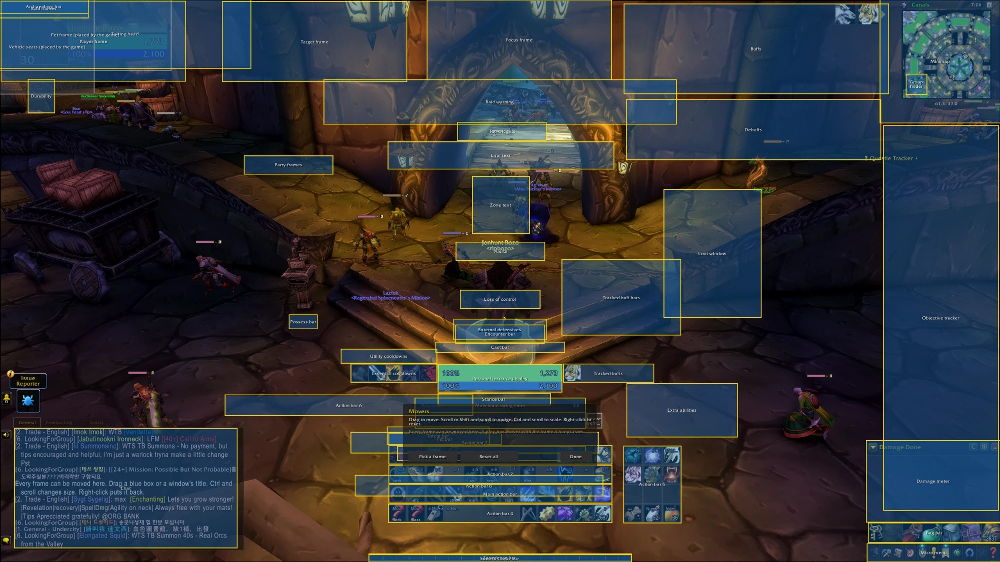

Test mode shows your frames on screen with sample content while you change options, so you can see a setting as you change it. It also shows the frames that stay hidden until a fight, a target or a group. Nothing you do in test mode is saved.

## Turning it on

Any of these turns test mode on, and pressing the same again turns it off:

- the **Test mode** switch on the title bar of the options window, left of **Close**;
- **Samples** on the toolbar of `/flatui move`;
- `/flatui test` (also `/flatui test on` and `/flatui test off`);
- a key: bind **Flat UI test mode** under Key Bindings > Flat UI in the game's options.

Test mode does not turn on while setup has the options window ("Flat UI: finish or close Setup first.").

Asked for in a fight, it waits: chat says "Flat UI: test mode comes on when the fight ends.", the switch shows its knob on but dimmed, and test mode comes on by itself as the fight ends, if what asked for it is still open. Asking a second time in the same fight takes that back ("Flat UI: test mode stays off.").

## The test mode bar

While test mode is on, a bar sits at the top of the screen. It moves under the `/flatui move` toolbar while that shows, and just above or under the options window where it would cover that window's title bar. Drag it to put it elsewhere; it opens there again, also after a reload.

| Control | What it does |
| --- | --- |
| **Group** | **Solo**, **Party**, **Raid 10**, **Raid 20** or **Raid 40**. **Party** at first, then the one you last picked on the account. |
| **Moving** | On: casts fill, health drifts and cooldowns run. Off holds every sample still, so a look can be judged. |
| **Bags**, **Bank** | Open or close Flat UI's bag and bank windows, with their real content |
| **Gear**, **Finder** | Open or close the **Gear comparison** window and the item finder |
| **Queue** | Opens or closes the **Trinket queue** window |
| **Move** | Opens `/flatui move` with the samples kept on, so you can place each frame where it shows. Press it again to close it. |
| **End** | Turns test mode off. Your settings stay as they were, and the bar keeps its **Group** and place. |

The bar's title counts the samples drawn now, as "Test mode · 14 samples". Point at it to see their names ("Shows now: Party frames, Focus frame, Threat list... and 6 more."). Double-click the title to put a dragged bar back at its own place.

A dim line under the bar names any frame that has no place yet, as "Focus frame: no place yet (open Edit Mode once)". A frame the game has never placed gets no sample, so it does not land in a corner.

Each control lights up under the mouse and has a one-line tooltip. The bar fades in and out with test mode.

## What shows

Each sample sits at its frame's saved place, scale and size, drawn with your current settings.

### Party and raid frames

- **Party frames**, with **Group** at **Party**, while you are in no group: Mara, a paladin tank and leader with a marker and aggro; Eli, a priest healer with a debuff you can dispel, your heals over time, out of range, whose health drifts; Ivo, a warlock at 16% after Life Tap, with a Voidwalker; and Fay, a dead rogue. With Edit Mode's Raid-Style Party Frames they are cells, you first.
- **Raid frames**, with **Raid 10**, **Raid 20** or **Raid 40**, while you are in no raid and the game shows no party frames: that many members in groups, at the cell size and group layout of your Edit Mode layout. They have every class and role, dead, offline and out of range members, debuffs you can dispel, markers on the tanks, a leader and two assistants, buffs and heals over time. Three members' health drifts, and two sit at 14%, so **Low health border** can be judged.

### Unit frames

- **Target**, **target of target** (with the game's Target of Target on), **focus**, **focus target**, **pet** and **boss** frames 1 to 5, while there is none, and a shaman's **totems**, whose time counts down.
- Their pictures are real ones: your own face on the target of target (which is you), a class icon on a party member and on a humanoid enemy, and a beast's icon on a beast.
- The **pet target frame**, while its row is on: a Training Dummy at 65%, at its place.
- A druid's **mana bar** under the player frame, at 60% in caster form, with the **Mark the cost of a shift** line.

### Cast bars, timers and rolls

- **Cast bars**: yours fills, channels and is interrupted in turn. The target's fills in **Interrupt ready colour**, turns Interrupted as if kicked, then shows a cast that cannot be interrupted. The focus's shows your interrupt on cooldown, then out of range, while **Interrupt readiness on enemy casts** is on. The pet's and first boss's run while their sample frame shows.
- The first round of a session plays **Sound when you are interrupted**, **Sound when your target casts** and **Sound when your interrupt lands** once each, if you picked one.
- **Swing timers**, while the game would show them.
- **Debuffs** and **buffs**, while you have none and their Edit Mode Visibility shows them.
- Two **loot rolls** at the loot rolls box, their seconds counting down, as **Seconds left on rolls** and **Sound before a roll ends** ask.
- A **Breath** timer at the timer bars spot, which drains over 30 seconds and loops, as **Breath and fatigue timers** draws the real one.

### The sample nameplate

A **sample nameplate** in the middle of the screen is your target, with its mark, its cast, its quest mark and kill count. Every 3 seconds it takes another threat state in turn, so you can judge each look:

- its threat colour, **Threat glow** and threat value, on the name, health text, border and background as the **Threat** tab asks;
- the enemy's target beside the bar with **Name of the enemy's target**;
- the fade of **Fade enemies held for you**;
- for a warrior or a hunter, the Overpower or Mongoose Bite icon over its auras;
- for a rogue or a druid, the combo points under it, gaining one each round.

Real nameplates are not forced on screen, so threat colours show on the sample plate, not on your target's plate.

### Flat UI's own frames

- **Combat text** and **combat alerts**, such as Low health and Low mana, and the **cooldown pulse**.
- **Flat UI's action buttons**: every 5 seconds, a cast fill, an interrupt flash followed by **Proc glow**, an aim pulse and a sample cooldown sweep in **Sweep colour** that ends with **Flash when ready**, on up to four buttons of your bars. With **Moving** off they hold still at a moment that shows each effect.
- **Cooldown icons**, with sweeps that loop, **Defensives on you**, **Your buffs** and **Absorb shields**.
- **Party cooldowns**, on your real rows or on sample rows, and **Enemy cooldowns** on the target and focus bars.
- **Trackers**, stepping fine, low and missing whatever their Show rule, and your class's first **proc alert** with its art and glow.
- The **threat list** and **healer mana**, with sample members whose threat and mana change as you watch.
- The **hit table**, the sample text of empty **data panel** slots, and the **experience bar**: a sample bar while your real one has nothing to show, and sample gains rising from it. Your real numbers stay as they are.
- **Group tools**, the **ping bar**, the **consumables bar**, the **cursor ring** and the **lava tick timer**.
- The new spell ranks line, and the **reload notice** as a dimmed sample while nothing needs a reload.
- **Charges**: a sample Lightning Shield with 3 charges that uses one every 2 seconds and is then cast again, while no buff with charges is on you.
- The minimap's text lines with sample values, as "45.2, 61.8" for the coordinates, "Durability 42%", the frame rate and the clock, while the real line has nothing to show, and the name of a sample ping, "Bex", every 5 seconds.
- The **Zone text** and **Error text** boxes, with "Elwynn Forest" and "Not enough mana", where the game shows them.

## How the samples behave

- Every change shows at once. A frame moved or scaled in `/flatui move` or Edit Mode takes its sample with it within a quarter of a second.
- The samples stay under the options window and the welcome screen, so the window's rows stay readable when you drag it over them.
- A sample steps aside as soon as the real frame shows: a real target, cast, group or aura.
- Esc > Edit Mode still shows the game's own previews, and the samples give way to them.
- A frame ticked on the **Hidden frames** page gets no sample, and neither does a frame that hangs from it, such as the pet frame, the totems or a cast bar locked to the player frame.

## When it ends

Test mode ends when:

- you press the switch, **Samples**, `/flatui test`, the key or **End** again;
- you close the options window it was turned on from (not while `/flatui move` holds that window);
- `/flatui move` closes for good after turning it on, unless the options window is open, which then keeps it;
- setup takes the options window;
- you reload.

A fight pauses it ("Flat UI: test mode pauses for the fight."), and the bar's title reads "Test mode · paused for the fight". It comes back after the fight while what turned it on is still open.

Test mode saves nothing: no setting, game setting, key binding, target or focus, and no number counts in a statistic. Only the bar's own **Group** and place are kept, for the account.

## What does not show, and why

- **The game's own unit frames are never shown or given a unit, and Flat UI never opens Edit Mode.** The game protects these frames, and doing either from an add-on taints them and can block targeting. The samples are Flat UI's own frames drawn where the game's are, so a sample can differ slightly from the real frame.
- **Real nameplates are not forced on screen**, since that would change game settings. Threat colours show on the sample plate.
- **The game's windows**, such as Character and Spellbook, are not opened, since an add-on opening them can taint the game's window manager. Open them yourself, and the **Windows** page restyles them as you change it.
- **No drawing exists** for the loot window, the queue panel, alerts, the talking head, the extra action button, arena and vehicle frames. Errands' overlays need the NPC's window open.
- **Chat and tooltips get no sample.** A printed line would skip the chat filters, and a tooltip shows on any mouse-over anyway.
- **Party cooldown rows hang in the raid stack**, not beside the party samples.

## Commands

| Command | What it does |
| --- | --- |
| `/flatui test` | Turns test mode on or off |
| `/flatui test on`, `/flatui test off` | Turns test mode on, or off |
| `/flatui test icons` | Shows three sample icons for 8 seconds on **Defensives on you**, **Your buffs**, **Party cooldowns** and **Enemy cooldowns** |
| `/flatui threat`, `/flatui healers` | Shows sample bars of the threat list or healer mana for a few seconds, out of combat |
| `/flatui combat test` | Shows sample combat numbers and one round of the combat alerts |
| `/flatui lava test` | Shows a sample of the lava tick timer for 8 seconds |

Every command is on the [Commands](Commands) page, and [Troubleshooting](Troubleshooting) has more on what waits in a fight.

Test mode draws the settings of every group. Each setting, with its default, is in the settings pages, from [Settings: Look](Settings-Look) to [Settings: Layout](Settings-Layout).
